# Báo cáo lab: Dữ liệu OSM khu Ocean Park 1 (OCP1): import, chuyển CRS, kiểm thử

**Ngày thực hiện:** 03/11/2026
**Phạm vi báo cáo:** Giai đoạn 2 (import OSM vào QGIS/PostGIS, chuyển sang EPSG:32648) và Giai đoạn 3 (test chuyển CRS, làm sạch geometry, xem trên QGIS).
**Phần lý thuyết:** xem [THEORY.md](THEORY.md).

---

## 1. Môi trường

| Thành phần | Phiên bản / cấu hình |
|---|---|
| QGIS | 3.44.15 (Windows), plugin QuickOSM 2.5.4 |
| PostgreSQL / PostGIS | 17.5 / 3.5.2 (GEOS 3.9, PROJ 7.2.1), Docker image `postgis/postgis:17-3.5` |
| Kết nối | `localhost:5433` → container `5432`, database `ocp1` (cấu hình trong [docker-compose.yml](docker-compose.yml), [.env](.env)) |
| Python | 3.13.1, geopandas 1.2.0, shapely 2.2.0, pyproj 3.8.0 (PROJ 9.8.1), pytest |

---

## 2. Giai đoạn 2: Import dữ liệu và chuyển CRS

### 2.1. Bản đồ nền và xác định khu vực

Thêm lớp `XYZ Tiles → OpenStreetMap` vào QGIS rồi zoom tới khu OCP1 (Hồ Ngọc Trai, VinUni, Học viện Nông nghiệp). Project tự nhận CRS **EPSG:3857 (Web Mercator)** từ lớp đầu tiên được thêm vào, và ô Coordinate hiển thị tọa độ bằng mét Web Mercator (`11793924, 2390829`).

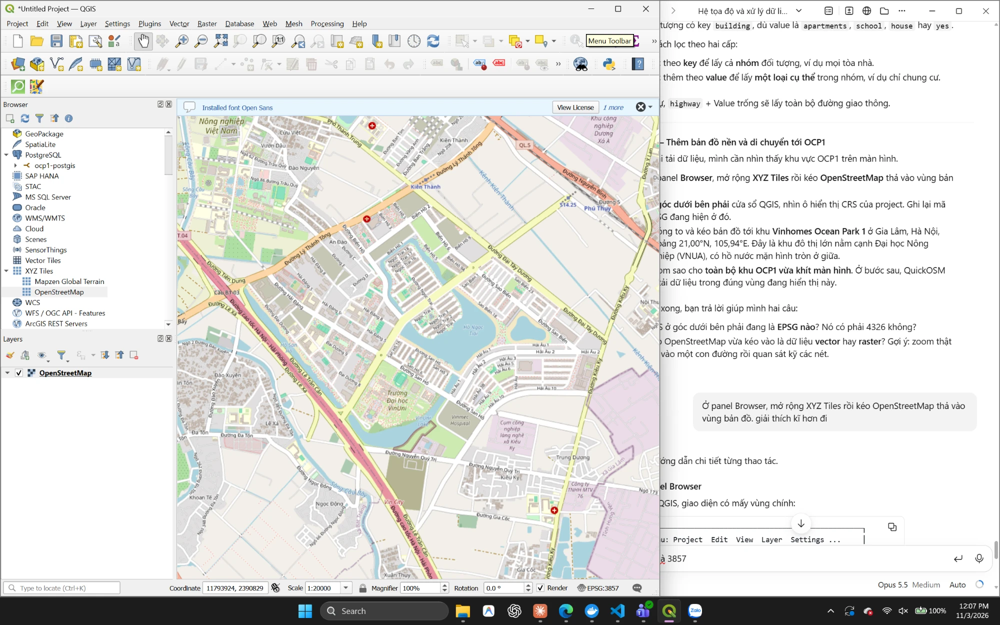

**Bản đồ nền là raster.** Zoom vượt mức chi tiết của tile (tỉ lệ 1:81) thì nhãn "NT01-06" bị nhòe, mép có răng cưa và chữ to lên theo mức zoom, vì chữ đã được "in" vào lưới pixel. Lớp này chỉ dùng làm nền, không phân tích được.

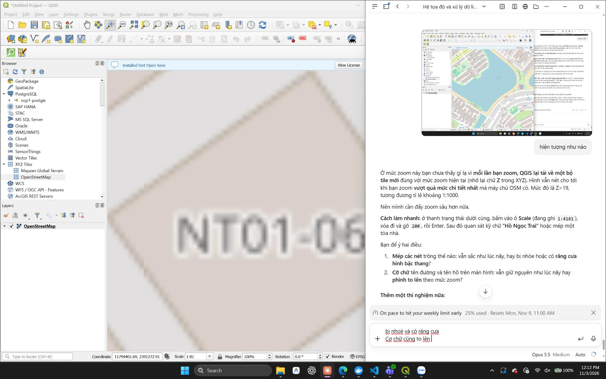

### 2.2. Tải dữ liệu vector bằng QuickOSM

Truy vấn: **Key = `building`, Value = (để trống, tức mọi giá trị), vùng = Canvas Extent**.

QuickOSM trả về **2 lớp** cùng tên `building`, vì mỗi lớp GIS chỉ chứa một kiểu geometry:

| Lớp | Kiểu | Nguồn phần tử OSM | Dùng cho lab |
|---|---|---|---|
| `building` (icon ô vuông) | Polygon | Way khép kín / Relation | ✅ |
| `building` (icon chấm) | Point | Node gắn tag `building` (không có đường viền) | ❌ không có diện tích |

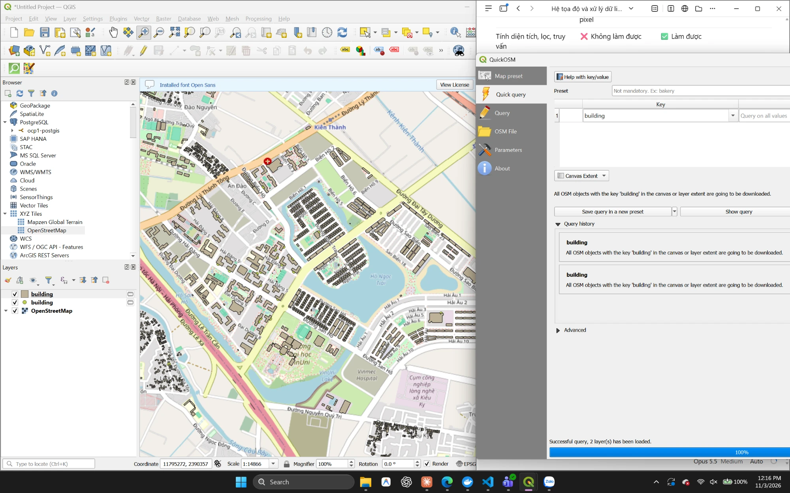

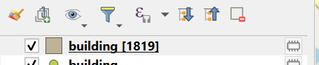

Lớp polygon được lưu ra **GeoPackage** [data/ocp1_4326.gpkg](data/ocp1_4326.gpkg). Kiểm tra bằng `ogrinfo`:

| Thuộc tính | Giá trị |
|---|---|
| Kiểu geometry | MultiPolygon |
| Số đối tượng | 1819 |
| CRS | EPSG:4326 |
| Extent | lon 105,933 → 105,963; lat 20,981 → 21,009 (khoảng 3,1 × 3,0 km) |
| Cột thuộc tính | Mỗi tag OSM thành một cột (`building`, `addr:street`, `name:vi`, …) |

### 2.3. Import vào PostGIS

**Sự cố kết nối và cách xử lý.** Lần đầu kết nối QGIS → PostGIS bị lỗi `Software caused connection abort`:

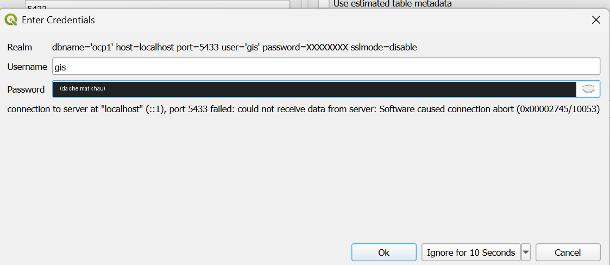

- Nguyên nhân: file `.env` có biến `PGPORT=5433`, mà PostgreSQL trong container đọc biến này nên chuyển sang lắng nghe cổng 5433 bên trong. Docker vẫn ánh xạ `5433 → 5432`, nên bên trong không có gì nghe ở cổng 5432. Log container xác nhận: `listening on IPv4 address "0.0.0.0", port 5433`.
- Healthcheck (`pg_isready`) vẫn báo `healthy` vì nó cũng đọc `PGPORT`.
- Khắc phục: đổi tên biến thành `HOST_PORT`, biến này chỉ dùng trong `docker-compose.yml`.

**Import bằng DB Manager** (`Database → DB Manager → Import Layer/File`): bảng `public.building_4326`, cột `geom`, SRID 4326, có tạo spatial index và chuyển tên cột sang chữ thường.

Trong DB Manager, schema `public` có cả hai bảng. Panel Info của `building_32648` hiển thị: 1819 dòng, cột `geom` kiểu MULTIPOLYGON, Spatial ref **WGS 84 / UTM zone 48N (32648)**, extent ước tính 597002 – 600088 / 2320350 – 2323391.

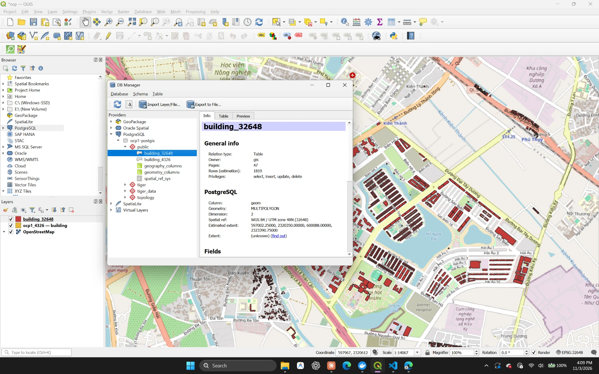

### 2.4. Chuyển CRS sang EPSG:32648

```sql
CREATE TABLE building_32648 AS
SELECT id, osm_id, osm_type, building, "name:vi" AS name_vi,
       ST_Transform(geom, 32648)::geometry(MultiPolygon, 32648) AS geom
FROM building_4326;

ALTER TABLE building_32648 ADD PRIMARY KEY (id);
CREATE INDEX ON building_32648 USING GIST (geom);
```

Kiểm tra trong PostGIS (toàn văn: [report/evidence/postgis_checks.txt](report/evidence/postgis_checks.txt)):

| Bảng | Số dòng | SRID | Geometry lỗi | Geometry rỗng | Chỉ mục |
|---|---|---|---|---|---|
| `building_4326` | 1819 | 4326 | 0 | 0 | pkey, GiST |
| `building_32648` | 1819 | 32648 | 0 | 0 | pkey, GiST |

Phạm vi tọa độ của `building_32648`: **x 597 002 → 600 088 m, y 2 320 350 → 2 323 391 m**, khớp với kích thước khoảng 3,1 × 3,0 km tính từ extent độ.

### 2.5. So sánh diện tích giữa các hệ

Ba tòa chung cư lớn nhất, chuẩn so sánh là `ST_Area(geom::geography)` (tính trên ellipsoid):

| id | 4326 (độ²) | Chuẩn geography (m²) | 32648 (m²) | Lệch 32648 | 3857 (m²) | Lệch 3857 |
|---|---|---|---|---|---|---|
| 542 | 0.0000002284 | 2 629,5 | 2 628,0 | **−0,057%** | 3 031,9 | **+15,3%** |
| 161 | 0.0000002252 | 2 592,0 | 2 590,6 | −0,056% | 2 989,0 | +15,3% |
| 136 | 0.0000002176 | 2 504,9 | 2 503,5 | −0,056% | 2 888,2 | +15,3% |

- **4326**: đơn vị độ², không dùng để đo đạc được.
- **32648**: lệch −0,056%. Nguyên nhân là hệ số tỉ lệ k ≈ 0,99972 tại OCP1, nơi cách kinh tuyến trục 105°E khoảng 98 km. Diện tích tỉ lệ với k², xấp xỉ 0,99944.
- **3857**: lệch +15,3%. Web Mercator phóng mỗi chiều lên 1/cos(21°) ≈ 1,07 lần, nên diện tích bị phóng lên khoảng 1,15 lần.

### 2.6. Hiển thị lớp 32648 trên QGIS

Đổi project CRS sang EPSG:32648 qua ô **Filter** trong `Project Properties → CRS`:

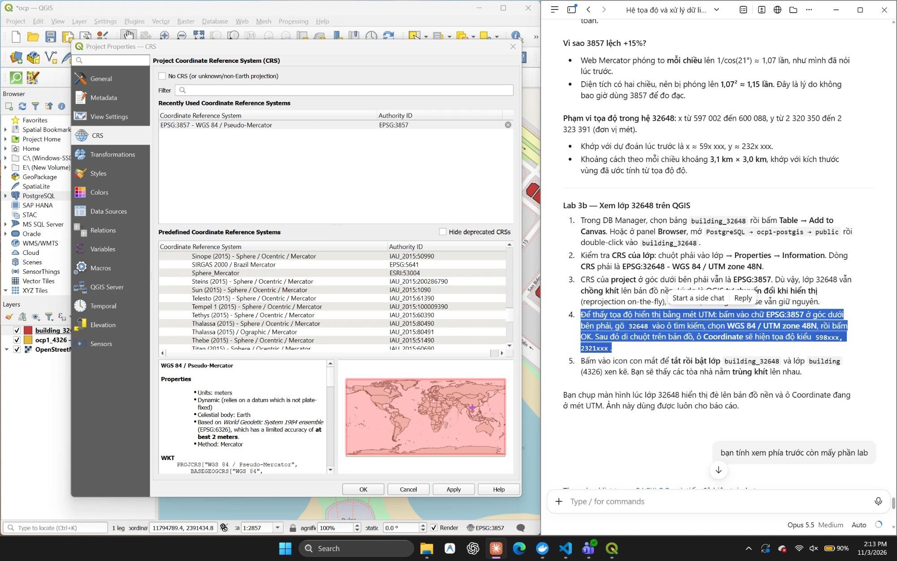

Lớp `building_32648` (màu đỏ) chồng khít lên bản đồ nền nhờ cơ chế reprojection on-the-fly của QGIS. Ô Coordinate hiển thị mét UTM: `599120.0, 2321806.5`.

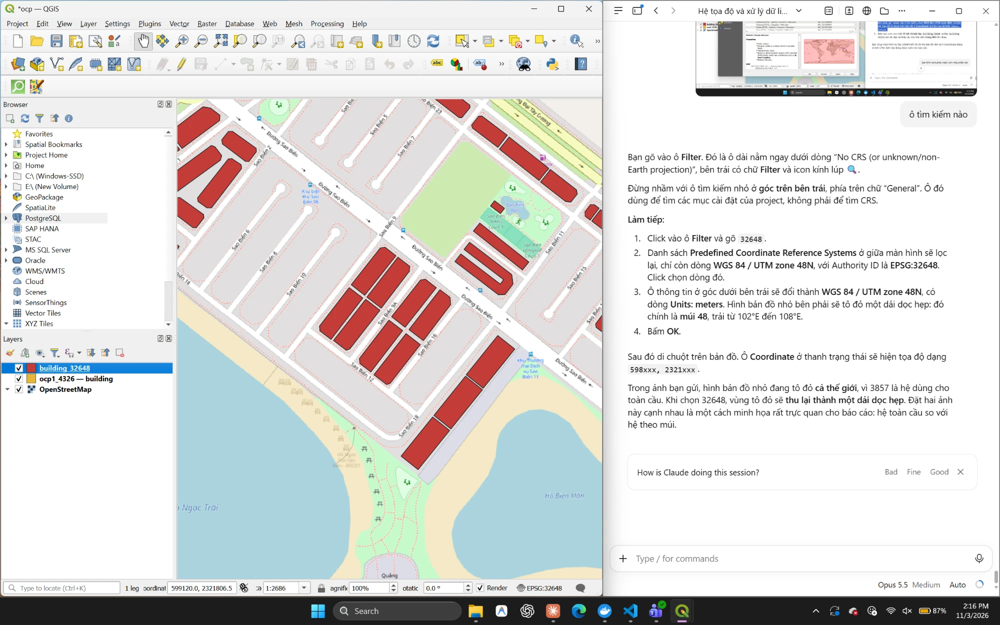

Layer Properties → Information của lớp `building_32648`: provider `postgres`, geometry Polygon (MultiPolygon), **Feature count 1,819**. CRS là **EPSG:32648 - WGS 84 / UTM zone 48N**, Units meters, Type Projected, Method Universal Transverse Mercator (UTM).

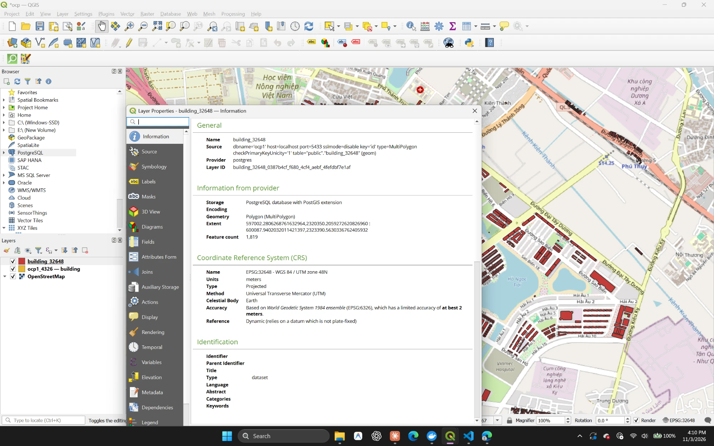

Hình so sánh cùng bộ dữ liệu ở hai hệ, đọc trực tiếp từ PostGIS bằng GeoPandas. Hình dạng giống nhau, chỉ khác trục: độ và mét.

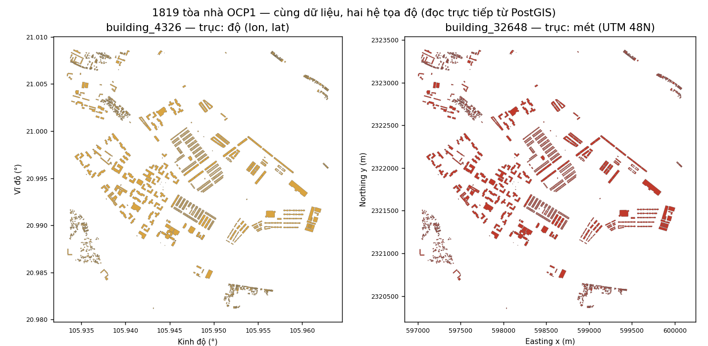

---

## 3. Giai đoạn 3: Kiểm thử

### 3.1. Cấu trúc code

```
src/crs.py          validate_lonlat, get_transformer, to_utm48n, to_wgs84, reproject_gdf, geodesic_area
src/clean.py        remove_empty, fix_invalid, keep_polygons, remove_repeated_points,
                    drop_duplicate_geometries, clean_geometries (ghép cả quy trình)
tests/conftest.py   dữ liệu mẫu (6 ca geometry + rỗng/null/trùng), fixture kết nối PostGIS
tests/test_crs.py       15 test
tests/test_clean.py     10 test
tests/test_postgis.py    5 test (tự skip nếu PostGIS không chạy)
```

Kết quả `python -m pytest -v`: **30 passed** (log đầy đủ: [report/evidence/pytest_output.txt](report/evidence/pytest_output.txt)).

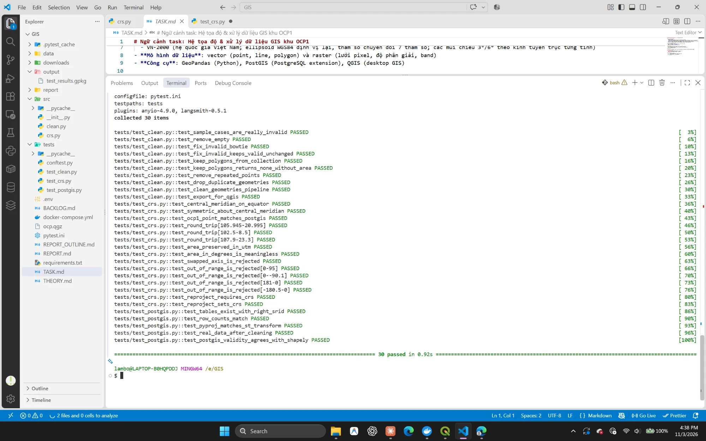

### 3.2. Test chuyển CRS ([tests/test_crs.py](tests/test_crs.py))

| Test | Kiểm tra | Kết quả |
|---|---|---|
| `test_central_meridian_on_equator` | (105°E, 0°) → x = 500 000, y = 0 | ✅ |
| `test_symmetric_about_central_meridian` | 104°E và 106°E đối xứng qua x = 500 000 | ✅ |
| `test_ocp1_point_matches_postgis` | (105.945, 20.995) → (598219.33, 2321884.50), khớp `ST_Transform` tới 1 cm | ✅ |
| `test_round_trip` ×3 | 4326 → 32648 → 4326, sai số < 1e-9° | ✅ |
| `test_area_preserved_in_utm` | Ô 100 × 100 m ở OCP1: diện tích thật 10 005,62 m², **sai số 0,0561%** | ✅ |
| `test_area_in_degrees_is_meaningless` | Cùng ô vuông trên 4326 = **8,692e-07 độ²**, GeoPandas cảnh báo "geographic CRS" | ✅ |
| `test_swapped_axis_is_rejected` | Truyền (lat, lon) thì báo `ValueError` "đảo trục" | ✅ |
| `test_out_of_range_is_rejected` ×4 | lat 95 / −90,1; lon 181 / −180,5 thì báo `ValueError` | ✅ |
| `test_reproject_requires_crs` | GeoDataFrame không có CRS thì báo `ValueError` | ✅ |
| `test_reproject_sets_crs` | Kết quả có EPSG 32648, đơn vị `metre`, bảng gốc vẫn là 4326 | ✅ |

**Bẫy thứ tự trục** (thí nghiệm với `pyproj.Transformer`, điểm OCP1):

| Cách gọi | Kết quả |
|---|---|
| `always_xy=True`, truyền (lon, lat) | `598219.33, 2321884.50` ✅ |
| `always_xy=False`, truyền (lon, lat) | `inf, inf` ❌ |
| `always_xy=False`, truyền (lat, lon) | `598219.33, 2321884.50` |

Theo chuẩn EPSG, hệ 4326 có thứ tự trục (lat, lon). Code dùng `always_xy=True` để thống nhất thứ tự (x, y) = (lon, lat) như PostGIS và QGIS, đồng thời gọi `validate_lonlat` để chặn dữ liệu bị đảo trục.

### 3.3. Test làm sạch geometry ([tests/test_clean.py](tests/test_clean.py))

Dữ liệu OCP1 thật có 0 geometry lỗi, nên các ca lỗi được tự tạo trong [tests/conftest.py](tests/conftest.py). Các ca này được đặt tại tọa độ 32648 ngay trong khu OCP1 để xem được trên QGIS.

| Ca | Lỗi (`is_valid_reason`) | Sau `clean_geometries` |
|---|---|---|
| `bowtie` | Self-intersection [5 5] | MultiPolygon 2 tam giác, mỗi tam giác 25 m² |
| `hole_outside` | Hole lies outside shell | MultiPolygon 2 phần, tổng 125 m² |
| `spike` | Ring Self-intersection [10 10] | `make_valid` trả về GeometryCollection(Polygon, LineString); `keep_polygons` bỏ đoạn gai, còn lại MultiPolygon 100 m² |
| `collapsed` | Too few points | Chỉ còn LineString, không có diện tích, **bị loại** |
| `repeated` | (hợp lệ, có đỉnh trùng) | Bỏ 1 đỉnh thừa (6 → 5 tọa độ), diện tích không đổi |
| `ok` | (hợp lệ) | **Giữ nguyên tuyệt đối** (`equals_exact`, tolerance 0) |
| `empty`, `null` | rỗng / None | **Bị loại** |
| `duplicate_of_ok` | trùng `ok` nhưng bắt đầu từ đỉnh khác | Phát hiện nhờ `normalize`, **bị loại** |

Báo cáo của quy trình: `{'input': 9, 'invalid_before': 4, 'removed_empty': 2, 'removed_non_polygon': 1, 'removed_duplicates': 1, 'invalid_after': 0, 'output': 5}`

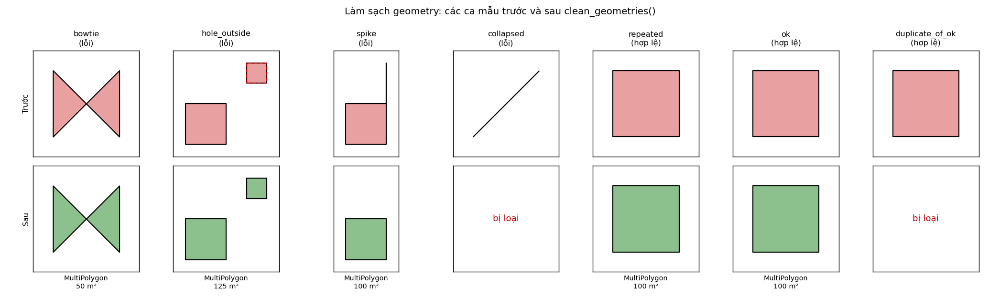

*Viền đỏ nét đứt ở ca `hole_outside` là "lỗ" nằm ngoài vỏ. Sau khi sửa, lỗ này trở thành một polygon riêng.*

### 3.4. Test trên dữ liệu thật trong PostGIS ([tests/test_postgis.py](tests/test_postgis.py))

| Test | Kết quả |
|---|---|
| Hai bảng tồn tại, SRID đúng (4326 / 32648) | ✅ |
| Số dòng hai bảng bằng nhau (1819), `ST_Transform` không làm mất dòng | ✅ |
| pyproj (PROJ 9.8.1) và `ST_Transform` (PROJ 7.2.1): chênh lệch tâm lớn nhất **1,42e-09 m** | ✅ |
| Làm sạch dữ liệu thật: 1819 vào, 1819 ra, 0 lỗi, 0 rỗng, 0 trùng | ✅ |
| `ST_IsValid` (PostGIS) và `is_valid` (shapely) cho cùng kết quả, vì cùng dùng GEOS | ✅ |

### 3.5. Xem kết quả trên QGIS

Test `test_export_for_qgis` ghi file [output/test_results.gpkg](output/test_results.gpkg), gồm lớp `before` (7 hình) và `after` (5 hình), CRS 32648.

Cách hiển thị: lớp `before` chỉ có **viền đỏ** (No Brush), lớp `after` **tô xanh lá**, Opacity khoảng 60%, project CRS EPSG:32648, tỉ lệ 1:1130. Các hình mẫu nằm ngay cạnh Trường Đại học VinUni. Đọc từ trái sang phải:

| Vị trí | Ca | Quan sát trên QGIS |
|---|---|---|
| 1 | `bowtie` | Viền đỏ hình số 8, được phủ xanh thành 2 tam giác |
| 2 | `hole_outside` | Ô vuông chính và ô nhỏ phía trên bên phải đều được phủ xanh, vì "lỗ" đã thành polygon riêng |
| 3 | `spike` | Ô vuông xanh, **đoạn gai đỏ thẳng đứng không được phủ xanh**, tức đã bị cắt bỏ |
| 4 | `collapsed` | **Chỉ có nét đỏ chéo, không có màu xanh**, tức đã bị loại |
| 5 | `repeated` | Ô vuông xanh, hình dạng không đổi |
| 6 | `ok` + `duplicate_of_ok` | Hai hình trùng khít cùng chỗ, chỉ còn **một** bản xanh, bản trùng đã bị loại |

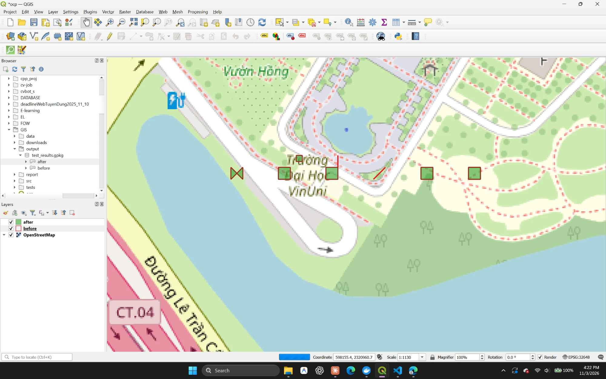

---

## 4. Nhận xét

1. **Dùng đúng hệ cho đúng việc.** 4326 dùng để lưu trữ và trao đổi, 3857 dùng để hiển thị trên web, còn đo đạc phải dùng hệ chiếu phẳng như 32648. Trên dữ liệu thật, 3857 phóng đại diện tích 15%, còn 32648 chỉ lệch 0,06%.
2. **Kiểm tra SRID và thứ tự trục ở mọi khâu.** Lỗi đảo trục và lỗi "không khai báo CRS" không làm chương trình dừng lại mà âm thầm cho ra kết quả sai. Vì vậy cần có test bắt buộc phải báo lỗi.
3. **Dữ liệu OSM khu OCP1 khá sạch** (0 geometry lỗi trên 1819 tòa nhà). Tuy vậy vẫn có những tòa nhà chỉ được vẽ thành điểm (lớp point), và phải loại chúng khi tính diện tích.
4. **Làm sạch không được làm hỏng dữ liệu tốt.** `fix_invalid` chỉ sửa những dòng lỗi, có test `equals_exact` bảo đảm điều này. Bước `keep_polygons` là bắt buộc, vì `make_valid` có thể trả về kiểu geometry hỗn hợp.
5. **Test không được phụ thuộc vào trạng thái bên ngoài.** Ban đầu `test_export_for_qgis` FAIL với `PermissionError: [WinError 32]`, vì QGIS đang mở `output/test_results.gpkg` và Windows khóa file đó. Đã sửa: test ghi và kiểm tra file ở thư mục tạm `tmp_path`, sau đó mới chép sang `output/`. Nếu file đang bị khóa thì test chỉ cảnh báo, không FAIL.
6. **Healthcheck báo xanh chưa có nghĩa là kết nối từ bên ngoài đã thông.** Cần kiểm tra bằng client thật, ví dụ QGIS hoặc Python.

## 5. Phụ lục: bằng chứng dạng văn bản

- [report/evidence/postgis_checks.txt](report/evidence/postgis_checks.txt): kết quả các truy vấn kiểm tra trong PostGIS
- [report/evidence/pytest_output.txt](report/evidence/pytest_output.txt): log đầy đủ `pytest -v -s`
