# Báo cáo lý thuyết: Hệ tọa độ, dữ liệu không gian và công cụ GIS

**Phạm vi:** WGS84 (EPSG:4326), UTM 48N (EPSG:32648), VN-2000; mô hình vector và raster; GeoPandas, PostGIS, QGIS.
**Khu vực ví dụ:** Vinhomes Ocean Park 1 (OCP1), Gia Lâm, Hà Nội, khoảng **20,99°N, 105,94°E**.
**Ngày:** 03/11/2026

> Báo cáo có 4 loại hình. **Sơ đồ khái niệm** (`figures/svg_*.svg`) do tác giả vẽ. **Biểu đồ** (`figures/fig_*.png`) được tính trực tiếp từ dữ liệu OSM của OCP1 bằng pyproj, shapely và matplotlib. **Ảnh chụp** (`figures/shot_*.png`) lấy từ QGIS trong quá trình làm lab. Các **số liệu** được đo bằng PostGIS 3.5 và PROJ.

---

## Mục lục

**Phần I — Khung khái niệm**
1. [Mô hình Trái Đất: mặt đất, geoid, ellipsoid](#1-mô-hình-trái-đất-mặt-đất-geoid-ellipsoid)
2. [Datum](#2-datum)
3. [Ba kiểu biểu diễn vị trí](#3-ba-kiểu-biểu-diễn-vị-trí)
4. [CRS = Datum + Cách biểu diễn](#4-crs--datum--cách-biểu-diễn)
5. [Mã EPSG](#5-mã-epsg)

**Phần II — Các hệ cụ thể**

6. [Họ WGS84: 4326, 4978, 32648, 3857](#6-họ-wgs84)
7. [Họ VN-2000: 4756, 3405, múi 3°](#7-họ-vn-2000)

**Phần III — Chuyển đổi và số liệu thực đo**

8. [Hai loại chuyển đổi](#8-hai-loại-chuyển-đổi)
9. [So sánh có số liệu](#9-so-sánh-có-số-liệu)

**Phần IV — Dữ liệu không gian**

10. [Vector và raster](#10-vector-và-raster)
11. [Cấu trúc một bản ghi vector](#11-cấu-trúc-một-bản-ghi-vector)
12. [Dữ liệu OSM](#12-dữ-liệu-osm)
13. [Tính hợp lệ của geometry](#13-tính-hợp-lệ-của-geometry)

**Phần V — Công cụ**

14. [Ba thư viện lõi: GEOS, PROJ, GDAL](#14-ba-thư-viện-lõi)
15. [GeoPandas, PostGIS, QGIS](#15-geopandas-postgis-qgis)

**Phần VI** — [Tài liệu tham khảo](#16-tài-liệu-tham-khảo)

---

# PHẦN I — KHUNG KHÁI NIỆM

## 1. Mô hình Trái Đất: mặt đất, geoid, ellipsoid

Muốn ghi lại vị trí trên Trái Đất, trước hết phải chọn một **bề mặt để đo**. Có ba bề mặt cần phân biệt:

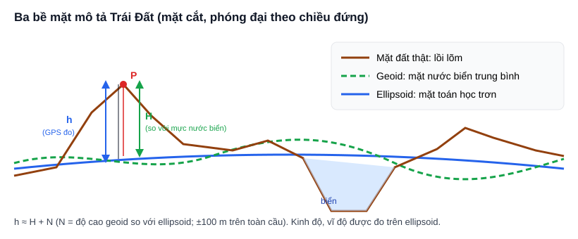

| Bề mặt | Bản chất | Dùng để |
|---|---|---|
| **Mặt đất thật** | Lồi lõm: núi, thung lũng, đáy biển. Không có công thức nào mô tả được | — |
| **Geoid** | Mặt đẳng thế trọng lực, gần trùng với **mực nước biển trung bình** kéo dài vào trong lục địa. Có lồi lõm nhẹ | Làm gốc cho **độ cao thủy chuẩn H** (độ cao "so với mực nước biển") |
| **Ellipsoid** | Elip xoay, trơn, có công thức chính xác. Bán trục lớn khoảng 6 378 km | Làm nền để tính **kinh độ và vĩ độ** |

Ellipsoid giống như một "quả bóng" toán học **to bằng Trái Đất** và trùm sát lên nó. Chênh lệch giữa ellipsoid và geoid trên toàn cầu chỉ khoảng **±100 m**.

**Hai loại độ cao:**
- **h, độ cao ellipsoid**: đo dọc theo pháp tuyến từ bề mặt ellipsoid lên tới điểm. GPS cho ra giá trị này.
- **H, độ cao thủy chuẩn**: đo so với geoid. Bản đồ địa hình dùng giá trị này.
- Liên hệ giữa hai giá trị: **h ≈ H + N**, trong đó N là độ cao geoid so với ellipsoid. Ở Việt Nam, N cỡ vài chục mét.

**Khoảng cách ngang và khoảng cách dốc.** Phần lớn phép tính GIS 2D, như `ST_Area` hay `ST_Length`, **chiếu mọi thứ xuống bề mặt tham chiếu**. Vì vậy chúng chỉ cho ra **khoảng cách ngang**. Theo Pythagoras, khoảng cách dốc thật là √(ngang² + chênh cao²). Khu OCP1 khá bằng phẳng nên hai khoảng cách gần như bằng nhau. Ở vùng núi, chênh lệch có thể rất lớn.

---

## 2. Datum

**Ellipsoid** mới chỉ là **hình dạng và kích thước**. **Datum** là ellipsoid đó cộng với **cách nó được đặt** so với Trái Đất thật:

| Thành phần của datum | Ý nghĩa |
|---|---|
| **Ellipsoid** | Bán trục lớn a, độ dẹt f |
| **Vị trí và hướng** | Tâm O nằm ở đâu, các trục xoay thế nào |
| **Kinh tuyến gốc** | Kinh độ 0° đặt ở đâu (thường là Greenwich) |
| *(Thời điểm, epoch)* | Mảng kiến tạo dịch chuyển vài cm mỗi năm. Chỉ cần quan tâm khi đo chính xác cỡ cm |

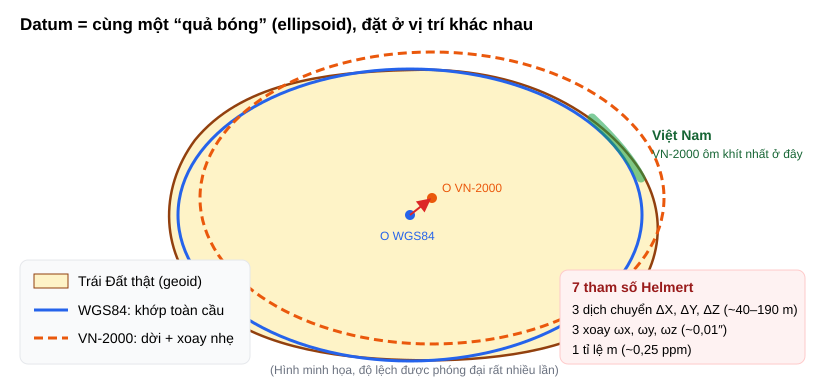

- **Datum toàn cầu (WGS84):** tâm ellipsoid trùng với **tâm khối lượng Trái Đất**. Ellipsoid được đặt sao cho khớp tốt nhất với geoid trên **toàn bộ hành tinh**.
- **Datum quốc gia (VN-2000):** lấy cùng ellipsoid đó nhưng **dời và xoay nhẹ** để nó **ôm khít nhất lãnh thổ Việt Nam**. Ở những vùng xa Việt Nam, độ khớp kém hơn, nhưng điều đó không quan trọng với Việt Nam.

**Vì sao các nước cần datum riêng?** Không phải vì GPS định vị sai trong WGS84. Tọa độ GPS trong hệ WGS84 là đúng. Các lý do thật sự là:
1. **Các nước đã có lưới đo đạc và bản đồ quốc gia từ trước khi có GPS.** Ví dụ Việt Nam có hệ HN-72. Hệ mới cần vừa khớp với lãnh thổ, vừa giữ liên tục với khối hồ sơ đã có.
2. **Ở từng vùng cụ thể, ellipsoid toàn cầu có thể lệch khá xa so với geoid.** Một datum "may đo" cho lãnh thổ giúp độ cao và phép chiếu bản đồ nhất quán hơn.
3. **Mảng kiến tạo trôi vài cm mỗi năm.** Một hệ gắn chặt với lãnh thổ cho tọa độ ổn định theo thời gian, phù hợp với hồ sơ địa chính.

Việc xây dựng và ban hành datum quốc gia do **cơ quan trắc địa quốc gia** thực hiện, và được quy định bằng văn bản pháp lý.

**Lưu ý:** cùng một ellipsoid **không có nghĩa là** cùng datum. VN-2000 dùng **đúng ellipsoid WGS84** (a và f giữ nguyên) nhưng vẫn là một datum khác. Cũng có những hệ dùng ellipsoid khác hẳn: hệ cũ HN-72 của Việt Nam dùng ellipsoid **Krasovsky**, có a = 6 378 245 m.

---

## 3. Ba kiểu biểu diễn vị trí

Khi đã có datum (một "quả bóng" đặt ở vị trí xác định), vẫn còn nhiều cách để **ghi vị trí của một điểm thành các con số**.

### 3.1 Kiểu địa lý: (vĩ độ, kinh độ), đơn vị độ

Kinh độ và vĩ độ **là các góc**:

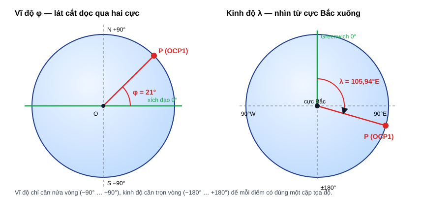

- **Vĩ độ φ** là góc giữa **mặt phẳng xích đạo** và đường thẳng đi qua điểm P. Nhận giá trị **−90° … +90°**; dương là bán cầu Bắc.
- **Kinh độ λ** là góc giữa **mặt phẳng kinh tuyến gốc** (Greenwich) và **mặt phẳng kinh tuyến đi qua P**. Nhận giá trị **−180° … +180°**; dương là phía Đông. Hai giá trị −180° và +180° là cùng một đường (đường đổi ngày). Một số nguồn dữ liệu dùng dải 0 … 360°, khi gặp phải đổi về dải chuẩn.

#### Vì sao vĩ độ chỉ đến ±90° còn kinh độ đến ±180°?

Mỗi điểm trên mặt cầu **chỉ được có đúng một cặp tọa độ**. Để vậy, cần một góc đi **trọn vòng** và một góc đi **nửa vòng**:

- **Kinh độ** chọn ra **một nửa vòng kinh tuyến** nối hai cực, giống như chọn một múi cam. Phải quay đủ 360° mới quét hết các múi. Chia đối xứng quanh Greenwich thì được ±180°.
- **Vĩ độ** cho biết điểm nằm ở đâu **trên nửa vòng đó**. Nửa vòng chỉ dài 180°, từ −90° lên +90°.
- Nếu cho vĩ độ vượt quá 90°, điểm sẽ đi qua cực và rơi sang múi đối diện, vốn đã có kinh độ riêng. Ví dụ, "vĩ độ 120°, kinh độ 0°" trùng với "vĩ độ 60°, kinh độ 180°". Một điểm lúc đó có hai cách ghi.
- Vĩ độ được chọn làm góc nửa vòng vì **trục quay của Trái Đất** tạo sẵn hai mốc tự nhiên: hai cực và xích đạo. Vĩ độ gắn với các hiện tượng vật lý như góc chiếu Mặt Trời, khí hậu, độ cao sao Bắc Cực. Kinh độ thì **không có mốc 0 tự nhiên**: mọi mặt phẳng kinh tuyến đều đi qua trục quay và đều vuông góc với xích đạo. Vì vậy năm 1884, các nước đã họp và **chọn Greenwich theo quy ước**.

Toán học cũng dùng cặp góc tương tự trong **hệ tọa độ cầu**: góc phương vị 0 … 360° và góc cực 0 … 180°. Vĩ độ bằng 90° trừ góc cực.

#### Cách ghi góc: DD và DMS

Quy đổi: **1° = 60′ (phút), 1′ = 60″ (giây)**. Ví dụ OCP1: **20,99°N; 105,94°E** (dạng DD) = **20°59′24″N; 105°56′24″E** (dạng DMS).

Độ chính xác tương ứng trên mặt đất: 1″ ≈ 30 m; 0,00001° ≈ 1,1 m; tọa độ có 7 chữ số thập phân ≈ 1 cm.

#### Độ dài thực của 1 độ

Độ dài cung = bán kính × góc. **1° vĩ độ** nằm trên vòng kinh tuyến nên luôn dài khoảng **111 km**. **1° kinh độ** nằm trên vòng vĩ tuyến, mà bán kính của vòng này là **R·cos φ**, nên độ dài co lại dần khi lên vĩ độ cao:

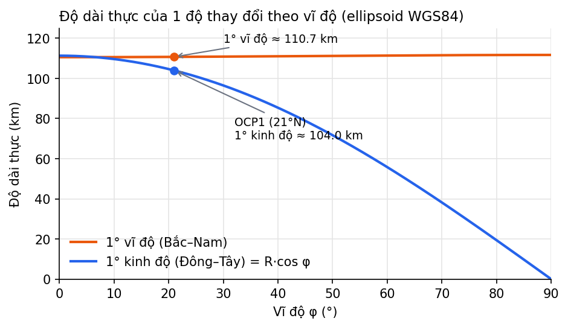

Tại OCP1 (21°N): 1° kinh độ ≈ **103,9 km**, 1° vĩ độ ≈ **110,7 km**. Một "ô vuông" 0,001° × 0,001° ngoài thực tế là hình chữ nhật khoảng **104 m × 111 m**. Vì vậy **không được tính khoảng cách hay diện tích trực tiếp trên tọa độ độ**.

#### Vĩ độ trắc địa và vĩ độ địa tâm

Ellipsoid hơi dẹt, nên có hai cách định nghĩa vĩ độ:
- **Vĩ độ địa tâm:** góc giữa mặt phẳng xích đạo và đường nối **tâm O** với điểm.
- **Vĩ độ trắc địa:** góc giữa mặt phẳng xích đạo và **pháp tuyến của ellipsoid** tại điểm. GPS và GIS dùng loại này.

Hai loại lệch nhau tối đa khoảng **0,19°** (ở vĩ độ 45°), tương đương khoảng **20 km** trên mặt đất.

Muốn mô tả vị trí 3 chiều, ta thêm độ cao h vào hai góc: bộ ba **(φ, λ, h)**.

### 3.2 Kiểu địa tâm: (X, Y, Z), đơn vị mét

Một cách khác là ghi **3 khoảng cách thẳng**, đo từ tâm ellipsoid theo 3 trục vuông góc. Hệ này gọi là **ECEF** (*Earth-Centered, Earth-Fixed*).

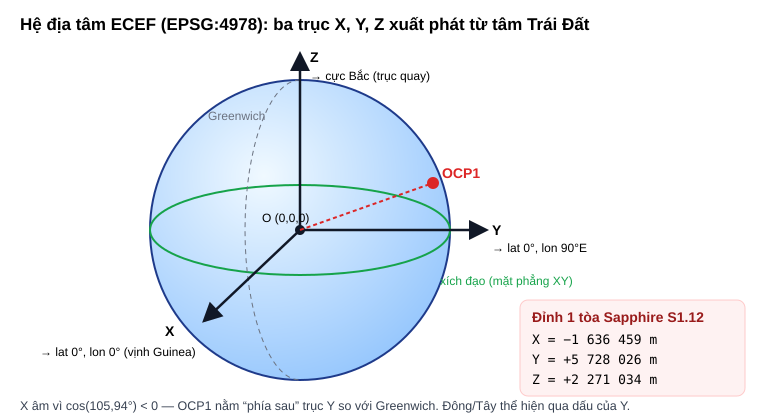

| Trục | Đi từ tâm O, xuyên qua |
|---|---|
| Z | Cực Bắc (trùng với trục quay) |
| X | Điểm lat 0°, lon 0° (vịnh Guinea, ngoài khơi châu Phi) |
| Y | Điểm lat 0°, lon 90°E (Ấn Độ Dương) |

**Lưu ý dễ nhầm:** gốc (0, 0, 0) của hệ XYZ nằm ở **tâm Trái Đất**. Còn điểm (lat 0°, lon 0°) nằm **trên bề mặt**; trong hệ XYZ, nó có tọa độ khoảng (6 378 137, 0, 0).

**Công thức chuyển từ (φ, λ, h) sang (X, Y, Z):**

```math
N = \frac{a}{\sqrt{1 - e^2 \sin^2\varphi}}
```

```math
X = (N + h)\cos\varphi\cos\lambda, \qquad
Y = (N + h)\cos\varphi\sin\lambda, \qquad
Z = \big(N(1 - e^2) + h\big)\sin\varphi
```

**Ví dụ:** đỉnh 1 của tòa Sapphire S1.12 ở OCP1 có X = −1 636 459 m, Y = +5 728 026 m, Z = +2 271 034 m. X mang dấu âm vì cos(105,94°) < 0. Việc điểm ở phía Đông hay phía Tây được thể hiện qua **dấu của Y** (sin λ).

Hệ XYZ ít được dùng trực tiếp trong GIS. Vai trò chính của nó là **làm nơi thực hiện phép đổi datum** (mục 8.2).

### 3.3 Kiểu chiếu phẳng: (E, N), đơn vị mét

Để đo đạc bằng **hình học phẳng thông thường**, ta **chiếu** mặt cong của ellipsoid xuống mặt phẳng. Không có phép chiếu nào giữ đúng đồng thời hình dạng, diện tích và khoảng cách. Mỗi phép chiếu hy sinh một vài tính chất để giữ những tính chất khác.

Kết quả là hai tọa độ trên mặt phẳng:
- **Easting (E)**: khoảng cách theo hướng Đông.
- **Northing (N)**: khoảng cách theo hướng Bắc.

Hệ chiếu phẳng **vẫn chỉ có 2 chỉ số**. Độ cao, nếu cần, được ghi riêng.

Với hệ chiếu phẳng, ta có thể dùng công thức quen thuộc: khoảng cách = √(ΔE² + ΔN²), diện tích tính bằng công thức shoelace. Chi tiết về phép chiếu UTM ở mục 6.3.

---

## 4. CRS = Datum + Cách biểu diễn

**CRS** (*Coordinate Reference System*, hệ quy chiếu tọa độ) là "**bản hướng dẫn đọc**" cho các con số tọa độ. Một cặp số như `(105.94, 20.99)` **chưa có nghĩa** nếu không biết nó thuộc CRS nào. Giống như "số 12" chưa tìm được nhà nếu không biết phố nào, quận nào.

**Một CRS gồm hai thành phần chính:**

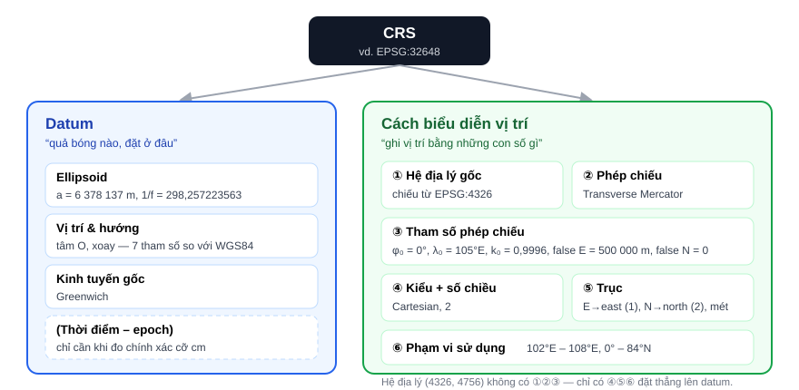

| Thành phần | Trả lời câu hỏi |
|---|---|
| **Datum** | Dùng quả bóng nào, đặt ở đâu? (mục 2) |
| **Cách biểu diễn vị trí** | Ghi vị trí bằng những con số gì? |
| ① Hệ địa lý gốc | Hệ chiếu phẳng được chiếu **từ** hệ (lat, lon) nào? |
| ② Phép chiếu | Dùng phương pháp gì để trải mặt cong ra mặt phẳng? |
| ③ Tham số của phép chiếu | Gốc tọa độ, kinh tuyến trục, hệ số tỉ lệ, false easting/northing. **Cùng phép chiếu, đổi tham số là ra một hệ khác** |
| ④ Kiểu hệ và số chiều | ellipsoidal 2D, Cartesian 2D hay Cartesian 3D |
| ⑤ Trục | Tên, **hướng**, **thứ tự** và đơn vị của từng trục |
| ⑥ Phạm vi sử dụng | Hệ được dùng ở vùng nào, trước khi độ méo vượt mức cho phép |

Hệ địa lý (như 4326) **không có ①②③**: chỉ có ④⑤⑥ đặt thẳng lên datum. Có hai thứ nằm ngoài CRS 2D nhưng hay gặp:
- **Hệ độ cao** (*vertical CRS*), ghép với CRS 2D thành **compound CRS**.
- **Thời điểm (epoch)** của tọa độ, thuộc phần datum.

**Bảng 2 chiều: datum × kiểu tọa độ.** Đây là **xương sống** của cả báo cáo. Mỗi CRS là một ô:

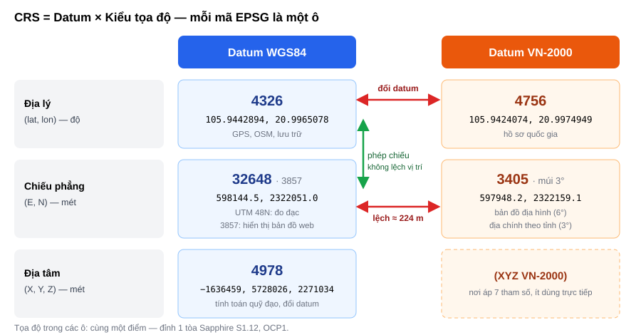

| Kiểu tọa độ ↓ \ Datum → | **WGS84** | **VN-2000** |
|---|---|---|
| **Địa lý** (lat, lon), độ | EPSG:**4326** | EPSG:**4756** |
| **Chiếu phẳng** (E, N), mét | EPSG:**32648** (UTM 48N), 3857 (Web Mercator) | EPSG:**3405** (UTM 48N), múi 3° theo từng tỉnh |
| **Địa tâm** (X, Y, Z), mét | EPSG:**4978** | (có tồn tại về mặt toán học, ít khi dùng trực tiếp) |

**Mỗi công cụ lưu CRS ở chỗ riêng:**
- QGIS: *layer CRS* và *project CRS*.
- PostGIS: **SRID** trên từng geometry, tra trong bảng `spatial_ref_sys`.
- GeoPandas: `gdf.crs`.
- Shapefile: file `.prj` đi kèm. GeoPackage: một bảng nội bộ. GeoJSON: mặc định là WGS84.

---

## 5. Mã EPSG

**EPSG** (*European Petroleum Survey Group*, hiện do **IOGP** quản lý) là **danh mục mã số** cho các CRS, giống một cuốn danh bạ. Mỗi mã là ID duy nhất của **một ô** trong bảng 2 chiều ở mục 4. Phần mềm chỉ cần đọc mã là biết đầy đủ datum, phép chiếu, trục và đơn vị.

Phân biệt **WGS84** với **EPSG:4326**: WGS84 là tên một **datum**. EPSG:4326 là **mã của một CRS cụ thể**, cụ thể là hệ địa lý (lat, lon) dựng trên datum WGS84. Khi người ta nói "dữ liệu WGS84", thường là đang nói về EPSG:4326, và **không có phép chuyển đổi nào giữa hai cái tên này**. Phép chuyển đổi chỉ xảy ra giữa **các CRS khác nhau**, ví dụ 4326 → 32648.

| Khoảng mã / mẫu | Loại | Ví dụ |
|---|---|---|
| 4000 – 4999 | Hệ địa lý | 4326 (WGS84), 4756 (VN-2000) |
| 2000 – 3999 | Nhiều hệ chiếu quốc gia hoặc vùng | 3405 (VN-2000 / UTM 48N), 3857 (Web Mercator) |
| **326zz** / **327zz** | WGS84 / UTM múi zz, bán cầu **Bắc** / **Nam** | **32648** = múi 48 Bắc; 32748 = múi 48 Nam |
| 4978 / 4979 | WGS84 địa tâm / WGS84 địa lý 3D | — |

Phần lớn các mã chỉ là số thứ tự trong danh mục. Riêng nhóm 326zz/327zz có cấu trúc như trên. Các con số trong **tên hệ** thì có ý nghĩa: "84" là năm 1984, "2000" là năm 2000.

**Định nghĩa đầy đủ** của một CRS có thể xem bằng lệnh `projinfo EPSG:32648`, kết quả ở dạng WKT2. Dưới đây là bản rút gọn, mỗi khối tương ứng với một thành phần ở mục 4:

```text
PROJCRS["WGS 84 / UTM zone 48N",
  BASEGEOGCRS["WGS 84", ELLIPSOID["WGS 84",6378137,298.257223563], PRIMEM["Greenwich",0]]   ← datum + ①
  CONVERSION["UTM zone 48N", METHOD["Transverse Mercator"],                                ← ②
    PARAMETER["Latitude of natural origin",0], PARAMETER["Longitude of natural origin",105], ← ③
    PARAMETER["Scale factor at natural origin",0.9996],
    PARAMETER["False easting",500000], PARAMETER["False northing",0]]
  CS[Cartesian,2],                                                                          ← ④
    AXIS["(E)",east,ORDER[1],LENGTHUNIT["metre",1]], AXIS["(N)",north,ORDER[2],...]         ← ⑤
  USAGE[AREA["Between 102°E and 108°E, northern hemisphere ..."], BBOX[0,102,84,108]]       ← ⑥
  ID["EPSG",32648]]
```

---

# PHẦN II — CÁC HỆ CỤ THỂ

## 6. Họ WGS84

### 6.1 Datum WGS84

**WGS84** (*World Geodetic System 1984*) là datum **toàn cầu, địa tâm**, do Bộ Quốc phòng Hoa Kỳ duy trì. Đây cũng là hệ quy chiếu của GPS. WGS84 thực ra là một **"ensemble"** gồm 8 phiên bản (Transit, G730, …, G2296), các phiên bản chênh nhau tối đa khoảng **2 m**. Với dữ liệu OSM thì không cần quan tâm, nhưng với đo đạc chính xác cỡ cm thì phải biết đang dùng phiên bản nào.

| Tham số ellipsoid | Giá trị |
|---|---|
| Bán trục lớn a | **6 378 137,0 m** |
| Độ dẹt nghịch đảo 1/f | **298,257223563** |
| Bán trục nhỏ b | ≈ 6 356 752,314 m (a − b ≈ 21,4 km) |
| e² | ≈ 0,00669438 |

### 6.2 EPSG:4326: hệ địa lý

- **Vì sao GPS và OSM dùng hệ này?** Vì đây là một hệ duy nhất cho toàn cầu, GPS tính trực tiếp trong WGS84, và hệ rất phù hợp để **lưu trữ và trao đổi** dữ liệu. 4326 trả lời câu hỏi "điểm này nằm **ở đâu**", không trả lời câu hỏi "hai điểm cách nhau **bao xa**".
- **Thứ tự trục:**
  - Chuẩn EPSG định nghĩa thứ tự **(Lat, Lon)**.
  - PostGIS, GeoJSON (RFC 7946), Shapely, GeoPandas và QGIS dùng **(Lon, Lat)**.
  - pyproj theo chuẩn EPSG, nên khi dùng phải truyền `always_xy=True`.
  - Đảo nhầm trục khiến `(105.94, 20.99)` biến thành vĩ độ 105,94°, một giá trị **không hợp lệ**. Có thể viết test kiểm tra |lat| ≤ 90 và |lon| ≤ 180 để bắt lỗi này.
- **Không dùng để đo đạc**: tính trên 4326 thì `ST_Area` ra **độ²**. Muốn đo đúng thì chuyển sang hệ chiếu đơn vị mét, hoặc dùng kiểu `geography` của PostGIS.

### 6.3 EPSG:32648: WGS84 / UTM zone 48N

**Phép chiếu Transverse Mercator.** Hình dung một **ống trụ nằm ngang** quấn quanh Trái Đất và chạm vào nó dọc theo **kinh tuyến trục**. Đây là phép chiếu **đồng góc** (giữ đúng góc và hình dạng ở phạm vi nhỏ). Độ méo gần bằng 0 trên kinh tuyến trục và **tăng theo bình phương khoảng cách** tới kinh tuyến trục.

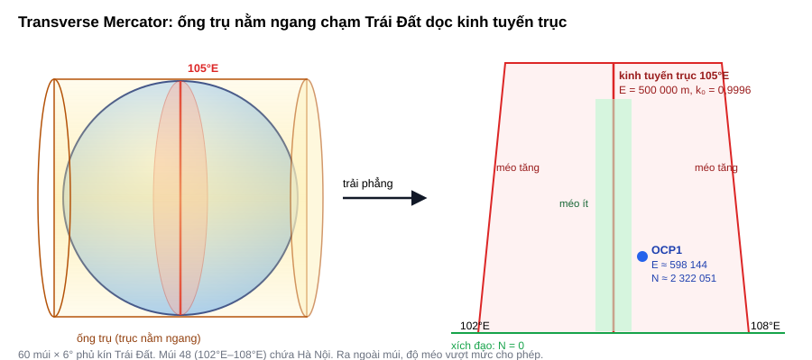

**Vì sao UTM là hệ "theo múi"?** Để giữ độ méo đủ nhỏ, mỗi phép chiếu chỉ dùng cho một dải rộng **6° kinh độ**. Phủ kín Trái Đất cần 60 múi, kinh tuyến trục của múi n là λ₀ = −183° + 6n. Mỗi múi có **gốc tọa độ riêng** và **mã EPSG riêng**, nên tọa độ ở hai múi khác nhau **không so sánh trực tiếp được**.
- **Múi 48:** λ₀ = **105°E**, trải từ 102°E đến 108°E. Phủ phần lớn miền Bắc và miền Trung Việt Nam.
- **Múi 49:** 108°E – 114°E.
- UTM chỉ áp dụng trong khoảng vĩ độ 80°S – 84°N.

**Hai chỉ số, đơn vị mét:**

| Chỉ số | Ý nghĩa | Đỉnh 1 tòa Sapphire S1.12 |
|---|---|---|
| **E (Easting)** | Kinh tuyến trục được gán E = **500 000** (*false easting*) để mọi giá trị E đều dương | **598 144,5**, tức cách kinh tuyến trục khoảng 98 km về phía Đông |
| **N (Northing)** | Khoảng cách tới **xích đạo** (bán cầu Bắc: N = 0 tại xích đạo; bán cầu Nam: N = 10 000 000 tại xích đạo) | **2 322 051,0**, tức cách xích đạo khoảng 2 322 km |

**Phạm vi:** E khoảng 166 000 → 834 000 m (ở xích đạo); N từ 0 → khoảng 9 330 000 m. Dữ liệu OCP1 nằm trong khoảng E 597 002 – 600 088, N 2 320 350 – 2 323 391, tức một vùng khoảng **3,1 km × 3,0 km**.

**Hệ số tỉ lệ.** Công thức gần đúng: **k ≈ k₀ (1 + E′²/2R²)**, với **k₀ = 0,9996** và E′ = E − 500 000. Hệ số k₀ được chọn hơi nhỏ hơn 1 để ở giữa múi thì độ dài hơi bị thu nhỏ, còn ở hai đường cách trục khoảng ±180 km thì k = 1. Nhờ vậy sai số được phân bố đều trên cả múi.

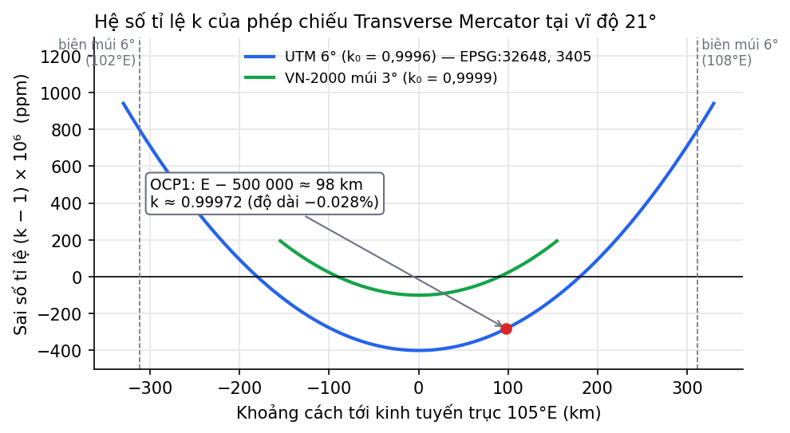

Tại OCP1, E′ ≈ 98 km, nên **k ≈ 0,99972**. Độ dài đo trên 32648 ngắn hơn thực tế khoảng 0,028%, còn diện tích (tỉ lệ với k²) nhỏ hơn khoảng **0,056%**.

**Độ hội tụ kinh tuyến:** γ ≈ (λ − λ₀)·sin φ ≈ 0,94° × sin 21° ≈ **0,34°**. Nghĩa là hướng "Bắc lưới" của UTM lệch khoảng 1/3 độ so với hướng Bắc thật. Vì vậy khi đặt CRS của project QGIS là 32648, bản đồ nền bị xoay rất nhẹ.

**"UTM 48N" chưa phải là một CRS đầy đủ**, vì nó chưa nói datum. Cùng cách chiếu UTM 48N có thể áp lên WGS84 (**32648**) hoặc lên VN-2000 (**3405**), và hai hệ này lệch nhau khoảng 224 m (mục 8.2).

**Cách ghi tọa độ UTM ngoài thực địa:** `48Q 598144 2322051`, trong đó **Q** là chữ cái của đai vĩ độ 16°N – 24°N. Cần cẩn thận vì chữ **"N"** trong "48N" nghĩa là *bán cầu Bắc*, nhưng **N cũng là tên một đai vĩ độ** (0° – 8°N).

### 6.4 EPSG:3857: Web Mercator

Đây là hệ của mọi **bản đồ web dạng tile**: OSM, Google Maps, và lớp XYZ Tiles trong QGIS. Hệ này dùng **công thức Mercator của mặt cầu** nhưng áp lên **vĩ độ của ellipsoid WGS84**. Đơn vị gọi là "mét" nhưng **không phải mét thật**: mỗi chiều bị phóng to khoảng **1/cos φ**. Ở Hà Nội, hệ số này khoảng 1,07. **Chỉ dùng 3857 để hiển thị, không dùng để đo đạc.**

---

## 7. Họ VN-2000

### 7.1 Cơ sở pháp lý và datum

- **Quyết định 83/2000/QĐ-TTg** (12/7/2000): sử dụng hệ VN-2000 thay cho hệ HN-72.
- **Thông tư 973/2001/TT-TCĐC** (20/6/2001): hướng dẫn áp dụng VN-2000, quy định múi chiếu và kinh tuyến trục cho từng tỉnh, cùng các tham số chuyển đổi.
- **Datum:** dùng **ellipsoid WGS84** nhưng **định vị lại** cho khớp với lãnh thổ Việt Nam. Điểm gốc N00 đặt tại Hà Nội.

### 7.2 Bảy tham số Helmert

Phép đổi datum được thực hiện trong **hệ XYZ** (mục 3.2): bộ trục của datum này được **dịch** và **xoay** so với bộ trục của datum kia.

| Nhóm | Tham số | Giá trị (`+towgs84` cho EPSG:4756, chiều VN-2000 → WGS84) |
|---|---|---|
| Dịch chuyển | ΔX, ΔY, ΔZ | −191,90441429 m; −39,30318279 m; −111,45032835 m |
| Xoay | ωx, ωy, ωz | −0,00928836″; +0,01975479″; −0,00427372″ |
| Tỉ lệ | m | +0,252906278 ppm |

```math
\begin{bmatrix} X_2 \\ Y_2 \\ Z_2 \end{bmatrix}
=
\begin{bmatrix} \Delta X \\ \Delta Y \\ \Delta Z \end{bmatrix}
+ (1+m)
\begin{bmatrix} 1 & -\omega_z & \omega_y \\ \omega_z & 1 & -\omega_x \\ -\omega_y & \omega_x & 1 \end{bmatrix}
\begin{bmatrix} X_1 \\ Y_1 \\ Z_1 \end{bmatrix}
```

Trong đó, (X₁, Y₁, Z₁) là tọa độ ECEF trong datum gốc, (X₂, Y₂, Z₂) là tọa độ ECEF trong datum đích. Các góc ω phải đổi từ giây cung sang radian (nhân với π / 648 000) trước khi thay vào công thức.

**Độ lớn của từng nhóm:**
- **Dịch chuyển** cỡ 40–190 m, là **thành phần chính** gây ra độ lệch.
- **Xoay** cỡ vài phần trăm giây cung, ứng với vài dm trên bề mặt Trái Đất.
- **Tỉ lệ** cỡ 0,25 ppm, ứng với vài mm trên quãng 10 km.

> ⚠️ **Cần đối chiếu với văn bản gốc.** Bộ giá trị trên được trích dẫn rộng rãi và có trong PROJ/EPSG. Tuy vậy, **dấu** của các tham số (chiều chuyển đổi) và **quy ước xoay** (*position vector* hay *coordinate frame*, hai quy ước này ngược dấu nhau ở ω) cần được đối chiếu với **Thông tư 973/2001/TT-TCĐC** trước khi dùng vào công việc chính thức.

### 7.3 Lưới chiếu và mã EPSG

| Loại múi | k₀ | Dùng cho | EPSG |
|---|---|---|---|
| 6° | 0,9996 | Bản đồ địa hình tỉ lệ nhỏ và vừa | **3405** (múi 48N, λ₀ = 105°E), **3406** (múi 49N, λ₀ = 111°E) |
| 3° | **0,9999** | Bản đồ địa chính, tỉ lệ lớn. **Kinh tuyến trục riêng cho từng tỉnh**; Hà Nội dùng **105°00′** | Có trong danh mục EPSG bản mới (ví dụ 9210, cần tra lại trên epsg.org để biết ứng với tỉnh nào) |

Hệ địa lý của VN-2000 là **EPSG:4756**.

Múi 3° hẹp hơn và có k₀ gần 1 hơn, nên trong phạm vi một tỉnh, độ méo nhỏ hơn nhiều so với UTM 6°. Xem đường màu xanh lá ở biểu đồ hệ số tỉ lệ, mục 6.3.

**Lưu ý môi trường lab:** PROJ 7.2.1 trong container PostGIS chỉ có các mã 4756 và 3405, **không có 9210**. Nếu cần múi 3° cho Hà Nội, phải tự khai báo CRS bằng chuỗi PROJ: `+proj=tmerc +lon_0=105 +k=0.9999 +x_0=500000 +ellps=WGS84 +towgs84=…`.

---

# PHẦN III — CHUYỂN ĐỔI VÀ SỐ LIỆU THỰC ĐO

## 8. Hai loại chuyển đổi

Trong bảng 2 chiều ở mục 4, mỗi hướng di chuyển là một loại chuyển đổi khác nhau.

### 8.1 Đổi kiểu tọa độ, giữ nguyên datum (di chuyển theo cột)

Đây là các phép chuyển như **4326 → 32648**, 4326 → 4978 hay 4326 → 3857. Chỉ dùng công thức toán (phép chiếu hoặc công thức ECEF), **vị trí ngoài đời không bị lệch**. Chuyển xong rồi chuyển ngược lại sẽ ra đúng điểm ban đầu.

**Cùng một điểm** (đỉnh 1 của tòa Sapphire S1.12) trong các hệ dùng datum WGS84, tính bằng PROJ:

| CRS | Tọa độ | Đơn vị |
|---|---|---|
| 4326 | 105.9442894, 20.9965078 | độ |
| 4979 | 105.9442894, 20.9965078, 0 | độ, độ, m |
| 4978 | −1636459.109, 5728025.656, 2271034.050 | m |
| 32648 | 598144.484, 2322050.952 | m |
| 3857 | 11793664.348, 2391462.185 | "m" |

### 8.2 Đổi datum (di chuyển theo hàng)

Đây là các phép chuyển như **4326 → 4756** hay **32648 → 3405**. Lúc này "quả bóng" bị dời đi, PROJ phải áp dụng **7 tham số Helmert**, và tọa độ của cùng một điểm bị lệch thật sự:

| CRS | Datum | Tọa độ của đỉnh 1 tòa Sapphire S1.12 |
|---|---|---|
| 4326 | WGS84 | 20,9965078°N; 105,9442894°E |
| 4756 | VN-2000 | 20,9974949°N; 105,9424074°E |
| 32648 | WGS84 | E 598 144,5; N 2 322 051,0 |
| 3405 | VN-2000 | E 597 948,2; N 2 322 159,1 |

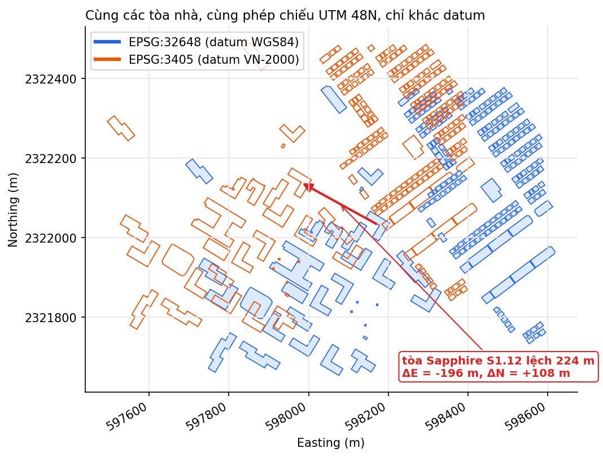

Cùng một tòa nhà, cùng phép chiếu UTM 48N, chỉ khác datum, mà tọa độ lệch nhau **ΔE ≈ −196 m, ΔN ≈ +108 m, tổng cộng khoảng 224 m**. Vì vậy **tuyệt đối không được trộn dữ liệu VN-2000 với dữ liệu WGS84** khi chưa chuyển đổi.

Muốn chuyển **32648 → 3405**, về nguyên tắc phải đi qua các bước 32648 → 4326 → 4756 → 3405. PROJ tự thực hiện các bước này khi gọi `ST_Transform` hoặc `to_crs`.

### 8.3 Gán nhãn và chuyển đổi

| Thao tác | GeoPandas | PostGIS | Các con số |
|---|---|---|---|
| **Gán nhãn**: dữ liệu đang thiếu CRS, cần khai báo nó thuộc hệ nào | `set_crs(4326)` | `ST_SetSRID(geom, 4326)` | **Giữ nguyên** |
| **Chuyển đổi**: đưa dữ liệu sang hệ khác | `to_crs(32648)` | `ST_Transform(geom, 32648)` | **Tính lại** |

Nhầm hai thao tác này là lỗi rất hay gặp. Ví dụ, gọi `ST_SetSRID(geom, 32648)` lên dữ liệu đang ở 4326 thì các con số `105.94, 20.99` bị hiểu thành E = 105,94 m, N = 20,99 m. Kết quả là cả khu OCP1 "rơi" xuống một điểm gần xích đạo, ở khoảng kinh độ 100,5°E (đảo Sumatra, Indonesia).

```python
from pyproj import Transformer
t = Transformer.from_crs(4326, 32648, always_xy=True)
t.transform(105.9442894, 20.9965078)          # → (598144.484, 2322050.952)
```

```sql
SELECT ST_AsText(ST_Transform(ST_SetSRID(ST_MakePoint(105.9442894, 20.9965078), 4326), 32648));
-- POINT(598144.484 2322050.952)
```

---

## 9. So sánh có số liệu

### 9.1 Diện tích cùng một tòa nhà theo từng CRS

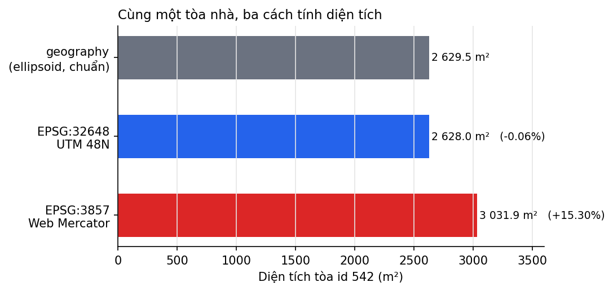

| Cách tính (tòa id 542) | Diện tích | Sai lệch |
|---|---|---|
| `ST_Area(geom::geography)`, tính trên ellipsoid, dùng làm chuẩn | **2 629,5 m²** | — |
| `ST_Area` trên 32648 | 2 628,0 m² | **−0,06%** |
| `ST_Area` trên 3857 | 3 031,9 m² | **+15,3%** |
| `ST_Area` trên 4326 | 0,0000002284 **độ²** | Không có ý nghĩa |

Hai tòa id 161 và id 136 cho cùng tỉ lệ sai lệch.

**Giải thích:**
- **32648 nhỏ hơn 0,06%:** tại OCP1, k ≈ 0,99972, nên k² ≈ 0,99944, tức nhỏ hơn khoảng 0,056%. Khớp với kết quả đo.
- **3857 lớn hơn 15,3%:**
  - Diện tích bị phóng lên khoảng 1/cos²φ ≈ 1,147, tức +14,7%.
  - Phần chênh thêm khoảng 0,6% là do 3857 dùng công thức của mặt cầu nhưng lại áp lên vĩ độ ellipsoid. Vì vậy 3857 không thật sự đồng góc: tỉ lệ theo hướng Bắc–Nam (≈1,077) lớn hơn tỉ lệ theo hướng Đông–Tây (≈1,071).
  - Tích hai tỉ lệ là ≈ 1,153, tức **+15,3%**, khớp với kết quả đo.
  - Đây cũng là lý do Greenland trên Google Maps trông to gần bằng châu Phi.

### 9.2 Khi nào dùng hệ nào

| | 4326 | 3857 | 32648 | VN-2000 (4756 / 3405 / múi 3°) |
|---|---|---|---|---|
| Kiểu | Địa lý | Chiếu | Chiếu | Địa lý / chiếu |
| Đơn vị | độ | "mét" | mét | độ / mét |
| Phạm vi | Toàn cầu | Toàn cầu (±85°) | Múi 102°E – 108°E | Việt Nam |
| **Dùng để** | Lưu trữ, trao đổi, GPS, OSM | Hiển thị bản đồ web | **Đo đạc, phân tích** khu vực miền Bắc | Hồ sơ địa chính, bản đồ chính thức |
| **Không nên** | Đo đạc | **Đo đạc** (sai +15%) | Dữ liệu trải qua nhiều múi | Trao đổi quốc tế |

---

# PHẦN IV — DỮ LIỆU KHÔNG GIAN

## 10. Vector và raster

| | **Vector** | **Raster** |
|---|---|---|
| Mô tả thế giới bằng | Đối tượng rời rạc: điểm, đường, vùng | Lưới ô vuông (pixel), mỗi ô một giá trị |
| Phù hợp với | Đối tượng có ranh giới rõ: tòa nhà, đường, thửa đất | Hiện tượng liên tục: độ cao (DEM), nhiệt độ, ảnh vệ tinh |
| Độ phân giải | Phụ thuộc độ chính xác của tọa độ | **Cố định** theo kích thước pixel |
| Khi zoom sâu | Luôn sắc nét | **Vỡ hạt, răng cưa** |
| Thuộc tính, diện tích | Có bảng thuộc tính; diện tích tính chính xác | Giá trị pixel; diện tích = số pixel × diện tích mỗi pixel |

**Cùng tòa Sapphire S1.12 dưới hai mô hình**, tính từ dữ liệu thật:

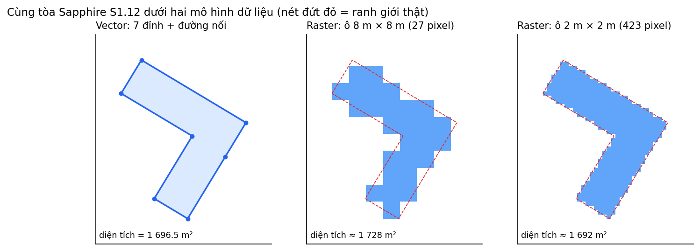

Raster càng mịn thì diện tích ước lượng càng gần giá trị vector (1 696,5 m²). Đổi lại, số pixel tăng theo bình phương: ô 8 m cần 27 pixel, ô 2 m cần 423 pixel.

**Quan sát trong lab:** lớp tile OpenStreetMap trong QGIS là **raster**. Ở tỉ lệ 1:4161 hình vẫn sắc nét, vì QGIS tải tile mới cho mỗi mức zoom. Khi zoom tới 1:81, vượt quá mức chi tiết nhất của tile (z = 19), chữ "NT01-06" bị **nhòe, răng cưa và phình to**, vì chữ đã bị "in chết" vào pixel ảnh.

| Tỉ lệ 1:4161: vẫn nét | Tỉ lệ 1:81: vỡ hạt |
|---|---|
| 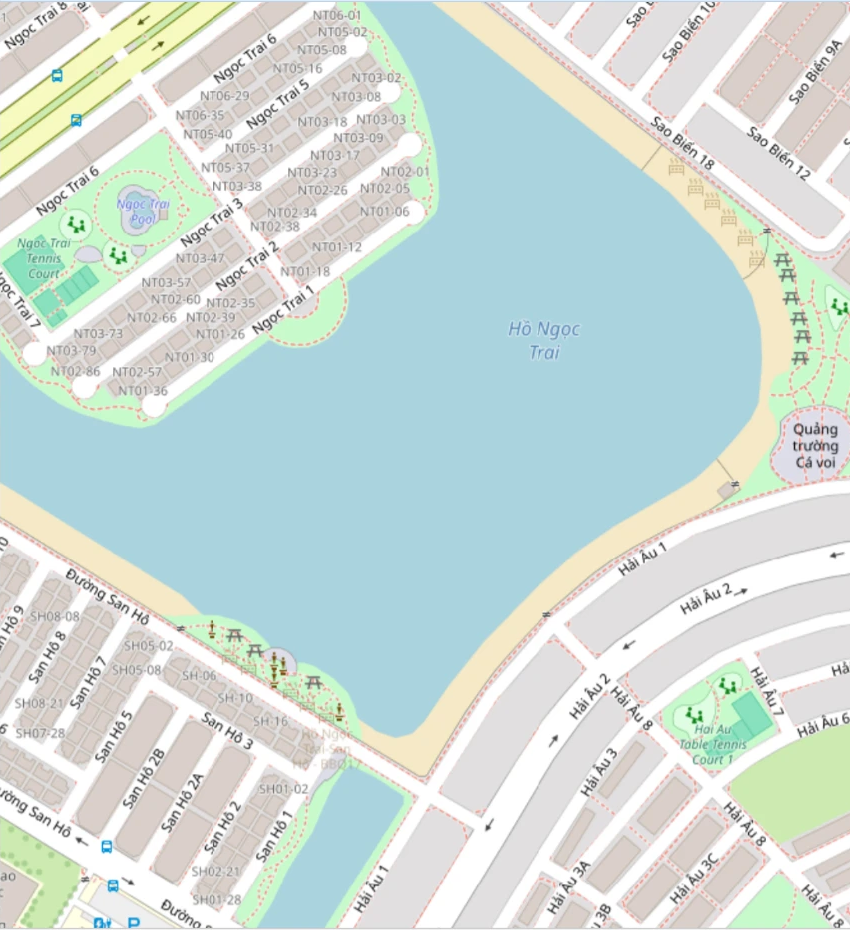 | 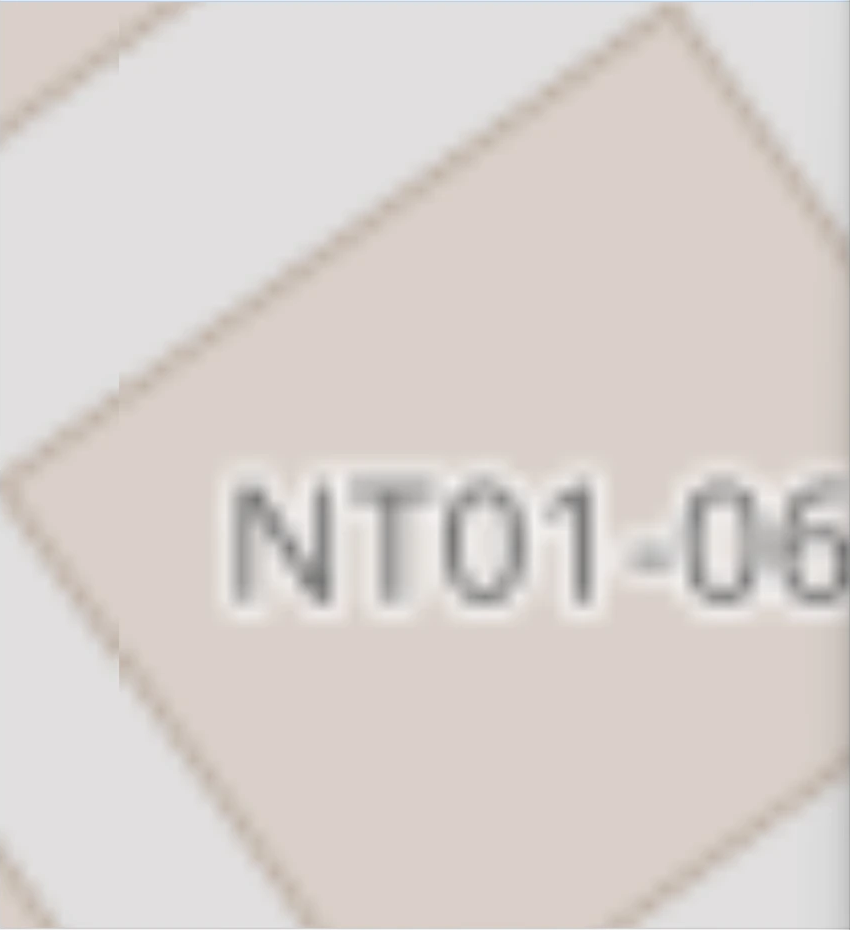 |

**Các định dạng file thường gặp:**

| Định dạng | Loại | Đặc điểm |
|---|---|---|
| **GeoPackage** (.gpkg) | Vector và raster | Chuẩn OGC. Một file SQLite duy nhất, chứa được nhiều lớp. **Nên dùng** |
| **Shapefile** (.shp) | Vector | Gồm nhiều file đi kèm; tên cột tối đa 10 ký tự; file tối đa 2 GB |
| **GeoJSON** | Vector | Dạng văn bản JSON. Theo RFC 7946 thì luôn dùng WGS84, thứ tự (lon, lat) |
| **GeoTIFF** | Raster | Ảnh TIFF có kèm thông tin tọa độ. Chuẩn cho DEM và ảnh vệ tinh |
| **XYZ tiles** | Raster | Ô ảnh 256×256 px, đánh địa chỉ theo `z/x/y`, dùng hệ 3857. Mức zoom z tăng thêm 1 thì số ô nhân lên 4 |

---

## 11. Cấu trúc một bản ghi vector

### 11.1 Ba lớp tách biệt

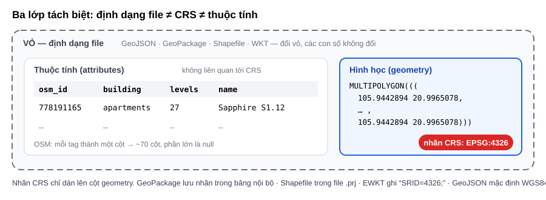

| Lớp | Là gì | Ví dụ so sánh |
|---|---|---|
| **Định dạng file** | **Cái vỏ**: cách sắp xếp và lưu dữ liệu | Phong bì |
| **CRS** | **Nhãn dán lên cột geometry**, cho biết phải đọc các con số như thế nào | Ngôn ngữ của bức thư |
| **Thuộc tính** | Các cột dữ liệu chữ và số bình thường | Nội dung bức thư |

- **Đổi vỏ, giữ nguyên CRS** thì các con số không đổi. Ví dụ GeoJSON `[105.9442894, 20.9965078]` và WKT `105.9442894 20.9965078` là cùng một điểm.
- **Giữ nguyên vỏ, đổi CRS** thì các con số thay đổi, dù vẫn chỉ cùng một vị trí ngoài đời. Ví dụ `POINT(105.94… 20.99…)` ở 4326 và `POINT(598144… 2322051…)` ở 32648.
- **Số cột thuộc tính không liên quan gì tới CRS.** Bảng `building_4326` có khoảng 70 cột vì mỗi tag OSM thành một cột. Bảng `building_32648` chỉ có 5 cột vì ở bước `ST_Transform` chỉ chọn giữ lại 5 cột.
- **WKT thuần không mang thông tin CRS.** Dạng **EWKT** của PostGIS ghi thêm CRS ở đầu: `SRID=4326;MULTIPOLYGON(...)`.

### 11.2 Geometry: các đỉnh nối theo thứ tự

Một polygon được lưu dưới dạng **danh sách các đỉnh**. Khi vẽ, phần mềm nối các đỉnh lần lượt 1 → 2 → … → n, rồi **quay về đỉnh 1**. Điểm cuối của danh sách luôn **trùng với điểm đầu** để vòng **khép kín**. Ví dụ tòa Sapphire S1.12 có 8 cặp tọa độ nhưng thật ra chỉ có 7 đỉnh.

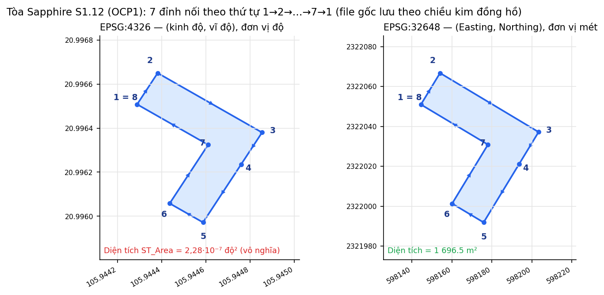

- **Polygon là phần diện tích bên trong**, không chỉ là cái khung. Đường viền gọi là **ring** (vòng). Polygon có thể có thêm **vòng trong**, đóng vai trò là **lỗ** (ví dụ sân trong của tòa nhà).
- **Thứ tự các đỉnh quyết định hình dạng.** Đổi thứ tự thì các cạnh có thể cắt chéo nhau, tạo thành hình nơ (bowtie). Xem mục 13.
- **Chiều đi vòng:**
  - GeoJSON (RFC 7946) quy định vòng ngoài đi **ngược chiều kim đồng hồ** và lỗ đi **cùng chiều kim đồng hồ**. Shapefile quy định ngược lại.
  - **OSM không quy định chiều**. Trong file `ocp1_4326.gpkg`, có **644 / 1819** vòng đi ngược chiều kim đồng hồ, số còn lại đi cùng chiều. Riêng tòa Sapphire S1.12 đi cùng chiều kim đồng hồ.
  - Khi xuất ra GeoJSON với tùy chọn `RFC7946=YES`, GDAL **tự đảo** các vòng về đúng quy ước.
- **Mỗi lớp chỉ chứa một kiểu geometry.** Vì vậy QuickOSM tách kết quả `building` thành hai lớp, một lớp polygon (1819 đối tượng) và một lớp point.

**Cấu trúc ngoặc lồng nhau của MultiPolygon:** MultiPolygon chứa các Polygon, mỗi Polygon chứa các ring, mỗi ring chứa các đỉnh, mỗi đỉnh là một cặp `[lon, lat]`.

```json
{"type": "MultiPolygon",
 "coordinates": [[[ [105.9442894, 20.9965078], [105.9446109, 20.9963244], "…", [105.9442894, 20.9965078] ]]]}
```

### 11.3 Các kiểu geometry (OGC Simple Features)

| Kiểu | Ví dụ ở OCP1 |
|---|---|
| Point | Cửa hàng, trạm xe buýt |
| LineString | Đường Ngọc Trai, Sao Biển |
| Polygon | Tòa nhà, Hồ Ngọc Trai |
| MultiPoint / MultiLineString / MultiPolygon | Tòa nhà gồm nhiều khối rời nhau |
| GeometryCollection | Kết quả của một số phép `ST_MakeValid` |

---

## 12. Dữ liệu OSM

**OpenStreetMap** là bản đồ thế giới mở do cộng đồng tình nguyện viên vẽ. Dữ liệu phát hành theo giấy phép **ODbL**: ai cũng được dùng, kể cả cho mục đích thương mại, nhưng phải ghi nguồn "© OpenStreetMap contributors". Dữ liệu lưu trong **WGS84**.

| Phần tử OSM | Cấu trúc | Geometry trong GIS |
|---|---|---|
| **Node** | Một điểm (lat, lon) | Point |
| **Way** | Chuỗi các node theo thứ tự | LineString; thành Polygon nếu khép kín và mang tag kiểu vùng |
| **Relation** | Nhóm các phần tử, mỗi phần tử có vai trò (role) | MultiPolygon, tuyến xe buýt… |

**Tag** mô tả ý nghĩa của phần tử theo dạng `key=value`:
- `building=apartments`: tòa chung cư.
- `building=yes`: tòa nhà, nhưng không ghi rõ loại.
- `highway=residential`: đường trong khu dân cư.

Truy vấn với `key=building` và **value để trống** sẽ lấy **mọi loại** tòa nhà.

**Chất lượng dữ liệu:** dữ liệu do cộng đồng vẽ nên có thể thiếu hoặc lỗi thời. Một tòa nhà chỉ được cắm bằng **Node** thì **không có diện tích**. Riêng 1819 polygon của OCP1 đã tải: **0 geometry không hợp lệ, 0 geometry rỗng**.

---

## 13. Tính hợp lệ của geometry

Chuẩn **OGC Simple Features** quy định thế nào là một geometry **hợp lệ**. Các phép tính như giao, hợp, diện tích có thể **cho kết quả sai hoặc báo lỗi** nếu geometry đầu vào không hợp lệ.

**Quy tắc chính với polygon:**
- Mỗi vòng phải khép kín, có ít nhất 4 điểm (tính cả điểm lặp lại để khép kín).
- Các cạnh không được tự cắt nhau.
- Lỗ phải nằm hoàn toàn bên trong vòng ngoài; các vòng chỉ được chạm nhau tại tối đa một điểm.
- Phần bên trong polygon phải liên thông.

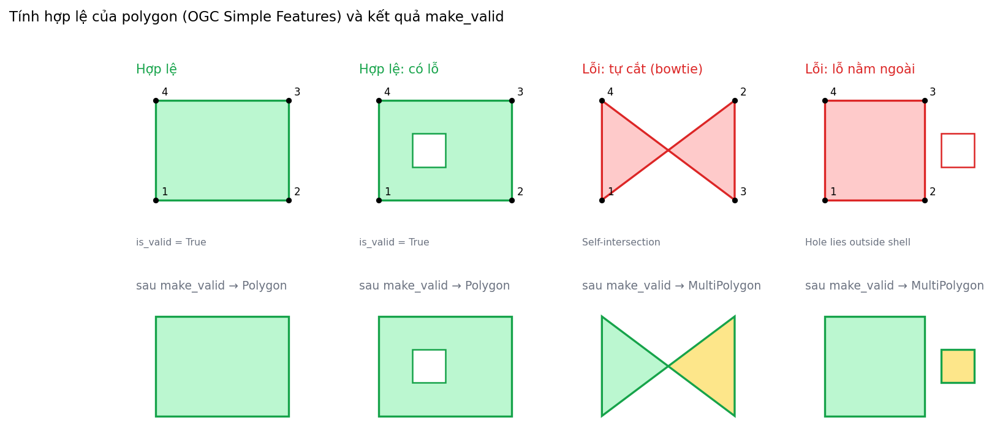

| Lỗi | Cách sửa thường dùng |
|---|---|
| Tự cắt (bowtie) | `make_valid`: tách thành MultiPolygon |
| Vòng không khép kín | Thêm điểm cuối trùng với điểm đầu |
| Điểm lặp liên tiếp | `ST_RemoveRepeatedPoints` |
| Quá ít điểm, diện tích bằng 0 | Loại bỏ |
| Lỗ nằm ngoài vòng ngoài, các lỗ chồng nhau | `make_valid` |
| Geometry rỗng hoặc NULL | Lọc bỏ |
| Đối tượng trùng lặp | Gom nhóm theo geometry |
| Sai kiểu, lẫn kiểu (ví dụ GeometryCollection sinh ra sau `make_valid`) | `ST_Multi`, `ST_CollectionExtract` |

Lưu ý: **hợp lệ (valid)** khác với **đơn giản (simple)**. Khái niệm "simple" dùng cho đường. Một LineString tự cắt chính nó vẫn hợp lệ, chỉ là không "simple".

---

# PHẦN V — CÔNG CỤ

## 14. Ba thư viện lõi

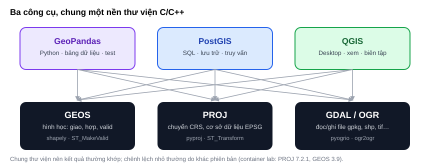

| Thư viện | Vai trò | Python | PostGIS |
|---|---|---|---|
| **GEOS** | Phép toán hình học, kiểm tra validity | `shapely` | `ST_Intersection`, `ST_IsValid`, `ST_MakeValid` |
| **PROJ** | Chuyển đổi CRS, cơ sở dữ liệu EPSG | `pyproj` | `ST_Transform` |
| **GDAL/OGR** | Đọc và ghi file | `pyogrio`, `rasterio` | `ogr2ogr` |

Vì cùng dùng các thư viện này, kết quả từ GeoPandas, PostGIS và QGIS **thường khớp nhau**. Chênh lệch nhỏ thường do **khác phiên bản**. Ví dụ, container của lab dùng PROJ 7.2.1 và GEOS 3.9, cũ hơn so với bản đi kèm QGIS 3.44.

## 15. GeoPandas, PostGIS, QGIS

### 15.1 GeoPandas

GeoPandas là pandas có thêm một cột **geometry** (dùng shapely) và thuộc tính **`crs`** (dùng pyproj).

| Hàm | Ý nghĩa |
|---|---|
| `gpd.read_file("data/ocp1_4326.gpkg")` | Đọc file |
| `gdf.to_crs(32648)` | **Chuyển đổi** tọa độ sang CRS khác |
| `gdf.set_crs(4326)` | Chỉ **gán nhãn** CRS, không đổi tọa độ |
| `gdf.is_valid`, `gdf.make_valid()` | Kiểm tra và sửa geometry |
| `gdf.area`, `gdf.length` | Đo theo đơn vị của CRS |
| `gpd.read_postgis(sql, engine, geom_col="geom")` / `gdf.to_postgis(...)` | Đọc và ghi PostGIS |

### 15.2 PostGIS

| Khái niệm / hàm | Ý nghĩa |
|---|---|
| `geometry` và `geography` | `geometry` tính trên mặt phẳng theo đơn vị của SRID. `geography` tính trên ellipsoid, luôn trả về m và m² |
| SRID, `spatial_ref_sys` | Mã CRS gắn với geometry; bảng danh sách các CRS |
| `geometry(MultiPolygon, 32648)` | Khai báo cột có ràng buộc kiểu và SRID |
| `ST_SetSRID` và `ST_Transform` | Gán nhãn, và chuyển đổi |
| `ST_IsValid`, `ST_IsValidReason`, `ST_MakeValid` | Kiểm tra và sửa geometry |
| Chỉ mục **GiST** | Chỉ mục không gian kiểu R-tree, giúp truy vấn theo vùng không phải quét toàn bảng |

```sql
CREATE TABLE building_32648 AS
SELECT id, osm_id, building,
       ST_Transform(geom, 32648)::geometry(MultiPolygon, 32648) AS geom
FROM building_4326;
CREATE INDEX ON building_32648 USING GIST (geom);
```

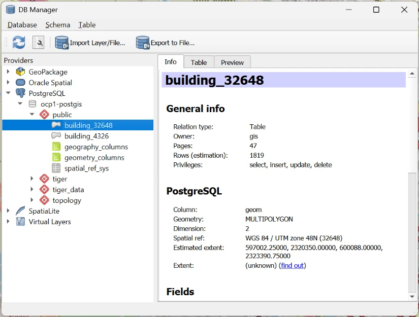

### 15.3 QGIS

| Khái niệm | Ý nghĩa |
|---|---|
| **Layer CRS** và **project CRS** | Layer CRS là hệ thật của dữ liệu. Project CRS là hệ dùng để hiển thị, xem ở góc dưới bên phải màn hình |
| **Reprojection on-the-fly** | QGIS tự chuyển các lớp sang project CRS khi vẽ, không sửa dữ liệu gốc |
| **XYZ Tiles** | Bản đồ nền raster, dùng hệ 3857 |
| **Lớp tạm** (*scratch layer*) | Chỉ nằm trong RAM. Cần **Export → Save Features As** để lưu |
| **QuickOSM** | Plugin tải dữ liệu OSM theo `key=value` và theo vùng (*Canvas Extent*) |
| **DB Manager** | Import vào PostGIS, chạy SQL |
| **Geometry Checker / Topology Checker** | Tìm geometry lỗi |
| **Identify Features** | Với lớp vector: hiện thuộc tính. Với lớp raster: hiện giá trị pixel |

Lớp `building_32648` (màu đỏ) hiển thị trên QGIS với project CRS là 32648. Ô Coordinate ở thanh trạng thái hiện tọa độ bằng mét UTM:

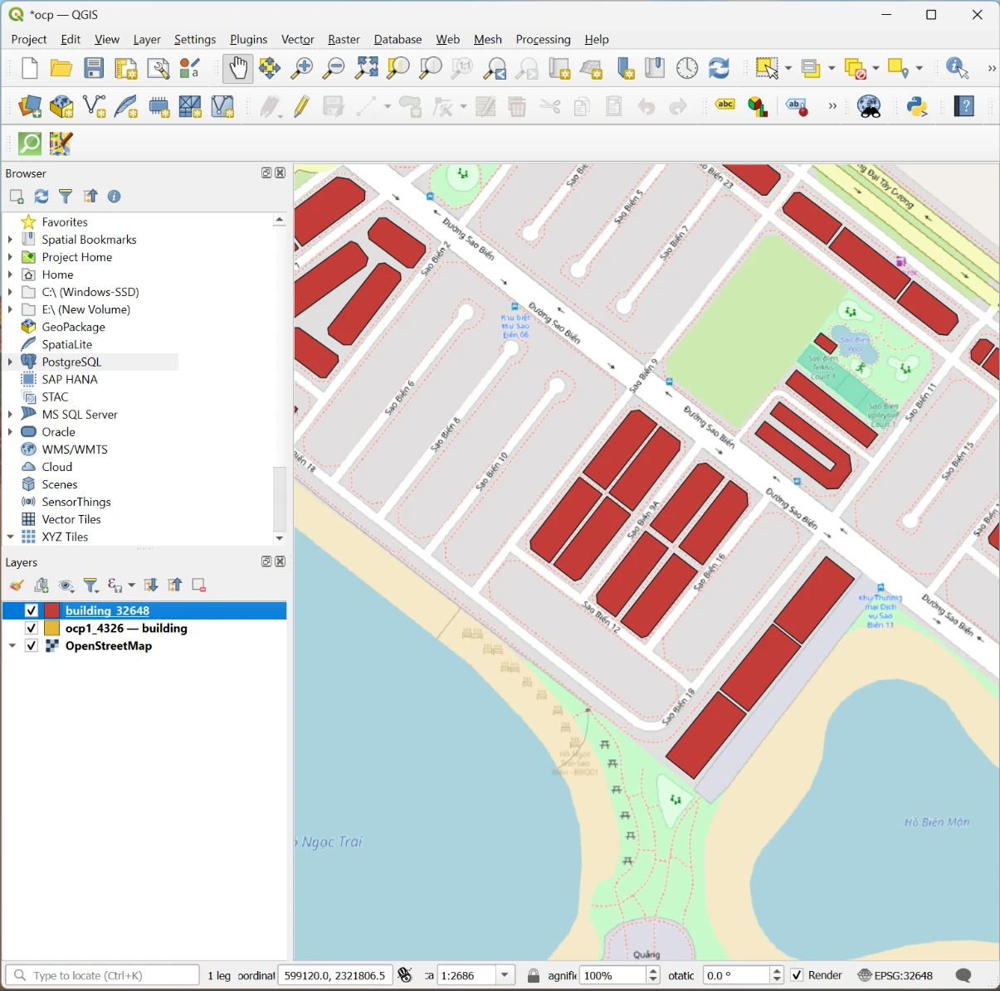

### 15.4 Quy trình trong lab

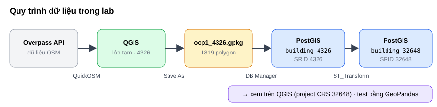

---

## 16. Tài liệu tham khảo

**Văn bản pháp lý**
1. Thủ tướng Chính phủ (2000). *Quyết định 83/2000/QĐ-TTg về việc sử dụng Hệ quy chiếu và Hệ tọa độ quốc gia Việt Nam*.
2. Tổng cục Địa chính (2001). *Thông tư 973/2001/TT-TCĐC hướng dẫn áp dụng hệ quy chiếu và hệ tọa độ quốc gia VN-2000*.

**Chuẩn và cơ sở dữ liệu**
3. NIMA (2000). *Department of Defense World Geodetic System 1984*, TR8350.2, 3rd ed.
4. IOGP. *EPSG Geodetic Parameter Dataset*: https://epsg.org
5. IOGP (2019). *Geomatics Guidance Note 7-2: Coordinate Conversions and Transformations including Formulas*.
6. OGC. *Simple Feature Access – Part 1: Common Architecture* (06-103r4).
7. OGC (2019). *Well-known text representation of coordinate reference systems* (WKT2, 18-010r7).
8. IETF (2016). *RFC 7946: The GeoJSON Format*.
9. OGC. *GeoPackage Encoding Standard*: https://www.geopackage.org

**Sách và bài báo**

10. Snyder, J. P. (1987). *Map Projections – A Working Manual*. USGS Professional Paper 1395.
11. Karney, C. F. F. (2011). Transverse Mercator with an accuracy of a few nanometers. *Journal of Geodesy* 85(8).

**Tài liệu phần mềm**

12. PostGIS: https://postgis.net/docs/
13. GeoPandas: https://geopandas.org
14. PROJ: https://proj.org
15. QGIS User Guide: https://docs.qgis.org
16. OpenStreetMap Wiki: https://wiki.openstreetmap.org
17. QuickOSM: https://plugins.qgis.org/plugins/QuickOSM/

**Nguồn hình:** các sơ đồ `svg_*` do tác giả vẽ. Các biểu đồ `fig_*` sinh từ dữ liệu OSM (© OpenStreetMap contributors, ODbL) bằng pyproj 3.8 (PROJ 9.8), shapely 2.2 và matplotlib 3.10. Các ảnh `shot_*` chụp từ QGIS 3.44, nền bản đồ © OpenStreetMap contributors.
